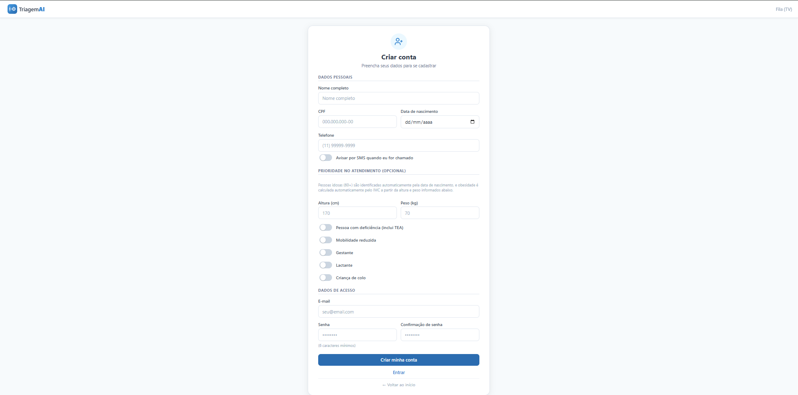
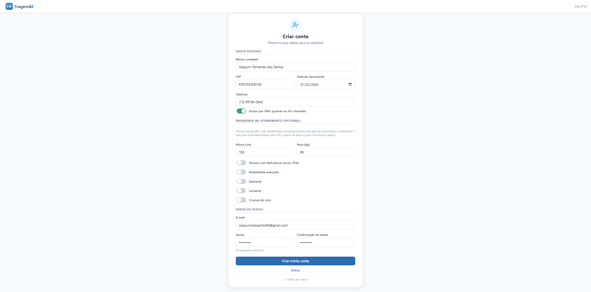
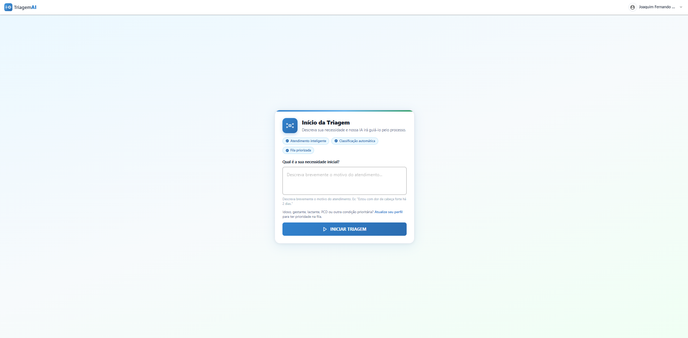
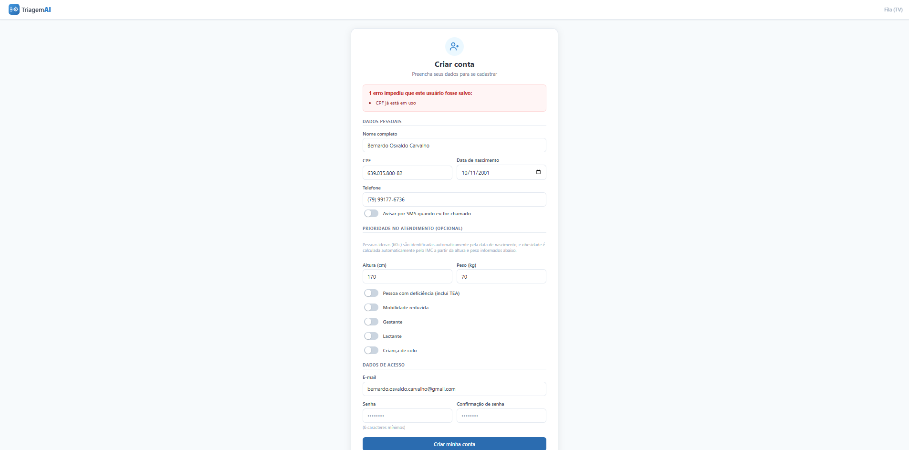
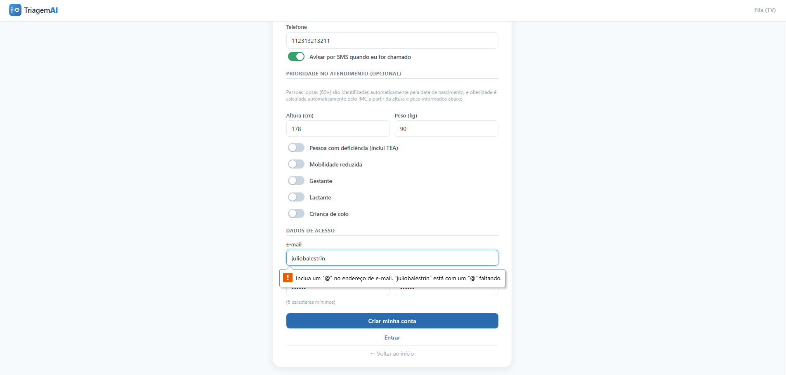
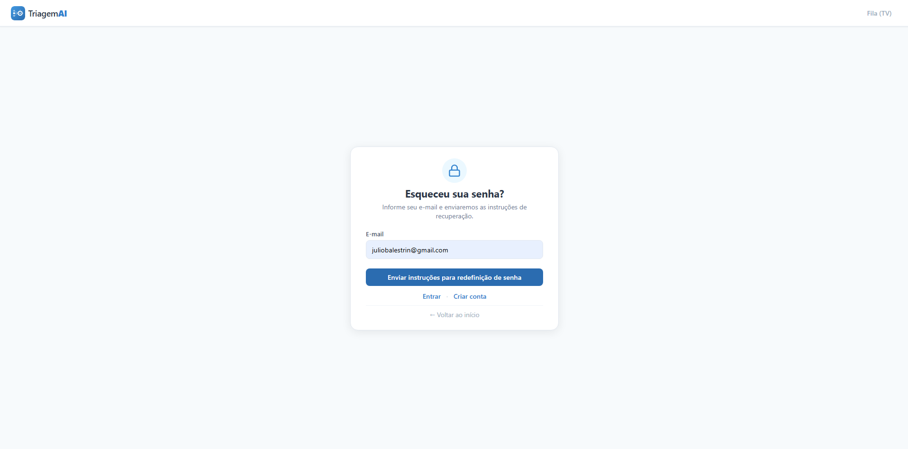

# UC01 – Cadastrar e fazer login (solicitante)

| Campo | Descrição |
|---|---|
| Ator(es) | Solicitante |
| Cenário de teste | Hospital ou Secretaria |
| Pré-condições | Acesso a /register ou /login |
| Pós-condição esperada | Usuário autenticado e direcionado ao /app. |
| Componentes/rotas | Devise; RegistrationsController; User. |
| Resultado esperado | Cadastro válido, acesso ao app e bloqueio das entradas inválidas. |
| Situação inicial | Executado manualmente em 20/10/2026 e 10/11/2026 – ver registro e parecer abaixo |

## Registro da execução

| Data / executor | Versão / cenário | Resultado obtido / status |
|---|---|---|
| 20/10/2026 (fluxo principal) e 10/11/2026 (fluxos alternativos) – Equipe TriagemAI | Branch ultimas-atualizacoes (commit 7ad705d); cenário Hospital (5 níveis, validação, check-in e revisão do especialista ativos) | Cadastro e login concluídos; usuário redirecionado para /app. Aprovado. |

## Fluxo principal – passos e evidências

UC01 – Passo 01: Acessar a página de cadastro /register.

Conferir: Formulário de registro disponível.

Figura A.1.1 – UC01, evidência do passo 01

Fonte: Captura de tela do TriagemAI (2026).

UC01 – Passo 02: Informar nome, CPF, e-mail e senha válidos.

Conferir: Campos preenchidos e sem avisos de erro.

Figura A.1.2 – UC01, evidência do passo 02

Fonte: Captura de tela do TriagemAI (2026).

UC01 – Passo 03: Entrar em /login com as credenciais cadastradas.

Conferir: Autenticação bem-sucedida e redirecionamento a /app.

Figura A.1.3 – UC01, evidência do passo 03

Fonte: Captura de tela do TriagemAI (2026).

## Fluxos alternativos e exceções – verificações obrigatórias

A01. CPF ausente ou já cadastrado deve ser recusado.

A02. E-mail ou senha inválidos devem ser recusados.

A03. Recuperação de senha por e-mail deve iniciar o fluxo previsto.

Fonte: Captura de tela do TriagemAI (2026).

A02

Fonte: Captura de tela do TriagemAI (2026).

A03

Fonte: Captura de tela do TriagemAI (2026).

## Resultado observado e parecer do caso de uso

| Campo | Resultado documentado |
|---|---|
| Resultado obtido | O sistema permitiu realizar o cadastro do solicitante com os dados obrigatórios e efetuar o login com sucesso, redirecionando o usuário para a aplicação. As informações cadastradas foram armazenadas corretamente. |
| Fluxos alternativos | A01: CPF ausente e CPF duplicado recusados (teste "UC01 A01"). A02: e-mail/senha inválidos recusados com "E-mail ou senha inválidos". A03: recuperação de senha gera token e envia 1 e-mail (teste "UC01 A03"). |
| Status final | [X] Aprovado   [ ] Aprovado com ressalva   [ ] Reprovado |
| Não conformidades | Nenhuma não conformidade identificada durante os testes realizados |
| Evidências complementares | Capturas de tela dos processos de cadastro, autenticação e validação dos fluxos alternativos, apresentadas nas Figuras A.1.1 a A.1.A. |
