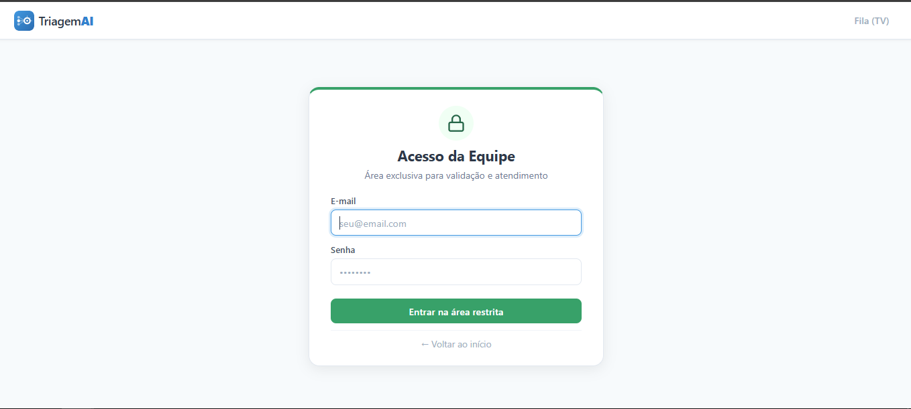
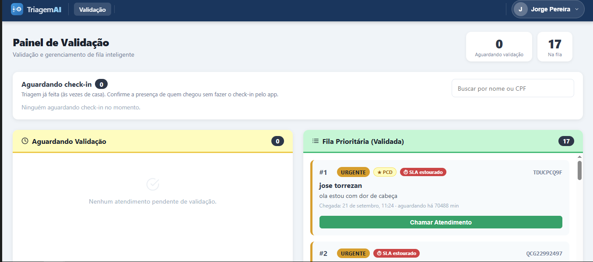
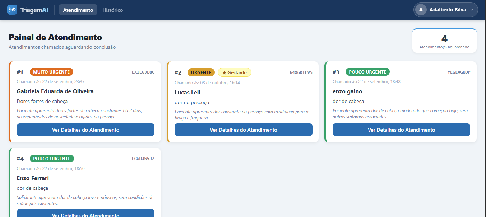
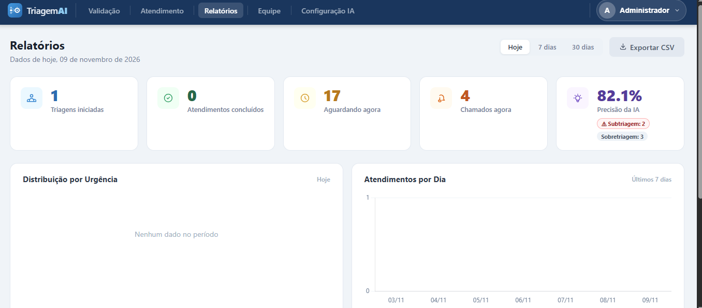
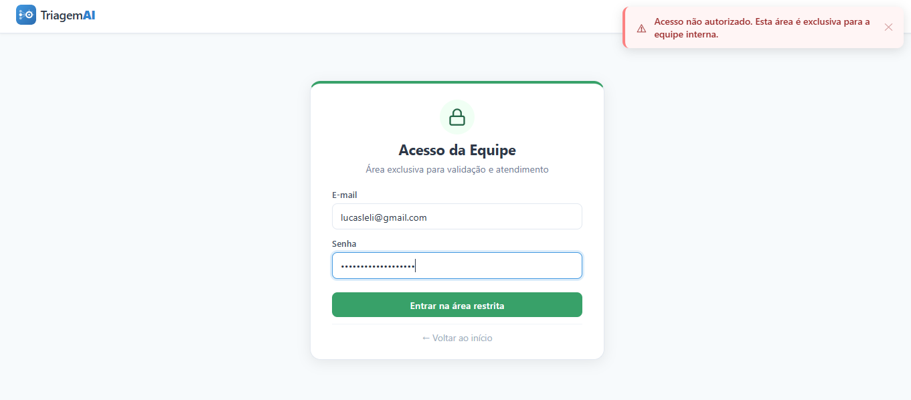
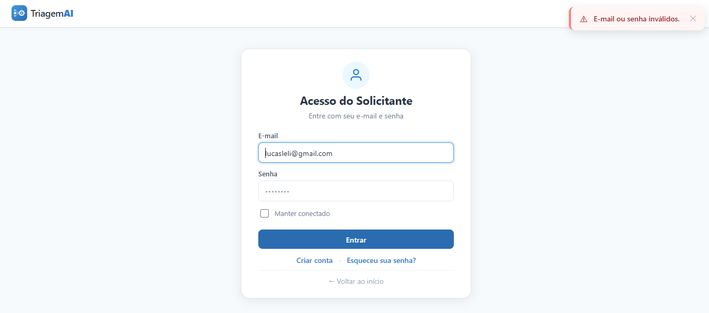
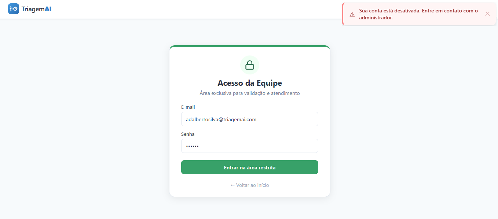

# UC02 – Login da equipe

| Campo | Descrição |
|---|---|
| Ator(es) | Colaborador; Especialista; Administrador |
| Cenário de teste | Hospital ou Secretaria |
| Pré-condições | Conta de equipe ativa. |
| Pós-condição esperada | Sessão autenticada e acesso ao painel do perfil. |
| Componentes/rotas | Staff::SessionsController; ApplicationController#after_sign_in_path_for. |
| Resultado esperado | Redirecionamentos e permissões corretos para os três perfis. |
| Situação inicial | Executado manualmente em 10/11/2026 – ver registro e parecer abaixo |

## Registro da execução

| Data / executor | Versão / cenário | Resultado obtido / status |
|---|---|---|
| 10/11/2026 – Equipe TriagemAI (execução no navegador + suíte automatizada) | Branch ultimas-atualizacoes (commit 7ad705d); cenário Hospital (5 níveis, validação, check-in e revisão do especialista ativos) | Colaborador → /validation, especialista → /attendance, admin → configuração da IA. Aprovado. |

## Fluxo principal – passos e evidências

UC02 – Passo 01: Abrir /staff/login.

Conferir: Tela própria de acesso da equipe.

Figura A.2.1 – UC02, evidência do passo 01

Fonte: Captura de tela do TriagemAI (2026).

UC02 – Passo 02: Informar credenciais válidas de colaborador.

Conferir: Redirecionamento a /validation.

Figura A.2.2 – UC02, evidência do passo 02

Fonte: Captura de tela do TriagemAI (2026).

UC02 – Passo 03: Repetir com conta de especialista.

Conferir: Redirecionamento a /attendance.

Figura A.2.3 – UC02, evidência do passo 03

Fonte: Captura de tela do TriagemAI (2026).

UC02 – Passo 04: Repetir com conta de administrador.

Conferir: Acesso ao painel administrativo.

Figura A.2.4 – UC02, evidência do passo 04

Fonte: Captura de tela do TriagemAI (2026).

## Fluxos alternativos e exceções – verificações obrigatórias

A01. Conta de solicitante não pode acessar área da equipe.

A02. Credenciais inválidas devem ser bloqueadas.

A03. Usuário da equipe desativado não pode autenticar.

Figura A.2.A – UC02, evidências das exceções/alternativas

Fonte: Captura de tela do TriagemAI (2026).

## Resultado observado e parecer do caso de uso

| Campo | Resultado documentado |
|---|---|
| Resultado obtido | Login pelo /staff/login autenticou o administrador e abriu o painel; o teste "UC02" confirmou os destinos de colaborador (/validation), especialista (/attendance) e administrador (/admin/triage_setting/edit). |
| Fluxos alternativos | A01: conta de solicitante em /staff/login recusada com "Acesso não autorizado. Esta área é exclusiva para a equipe interna." A02: senha errada recusada com "E-mail ou senha inválidos". A03: conta da equipe desativada permanece no /staff/login com aviso de conta desativada (teste existente). |
| Status final | [X] Aprovado   [ ] Aprovado com ressalva   [ ] Reprovado |
| Não conformidades | Nenhuma. |
| Evidências complementares | Execução no navegador em 10/11/2026; testes "UC02", "inactive staff member stays on the staff login page" e "wrong password on the staff login…". Suíte automatizada final: 111 testes, 261 asserções, 0 falhas (bin/rails test, 25/11/2026, tag tcc-final-2026-11-25). |
