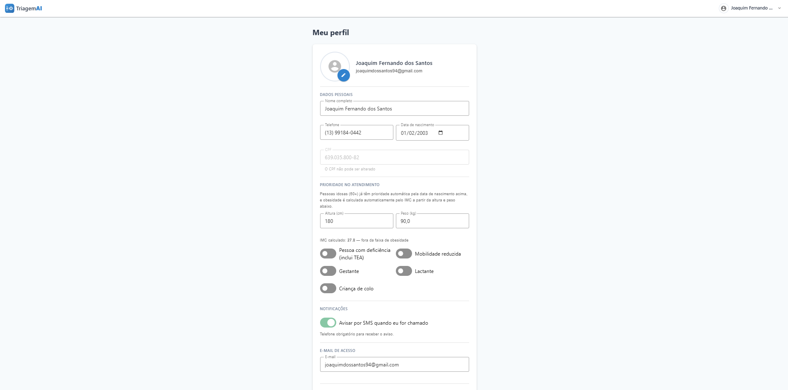
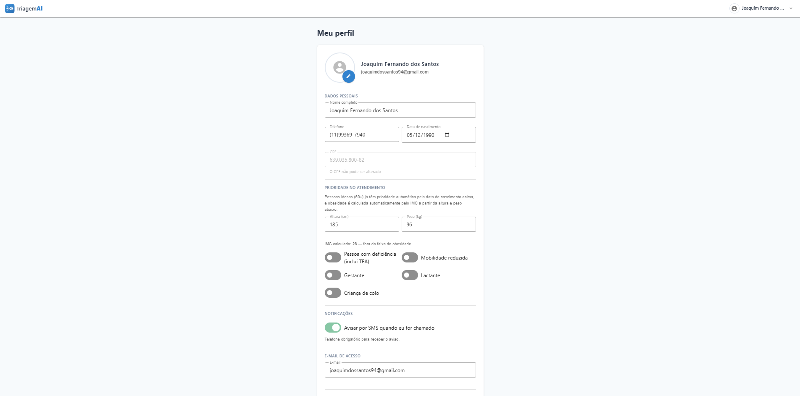
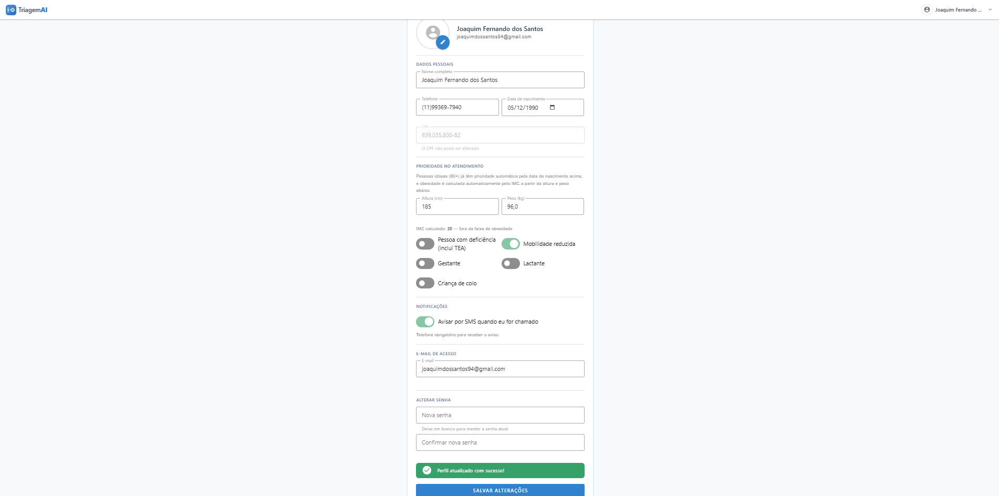
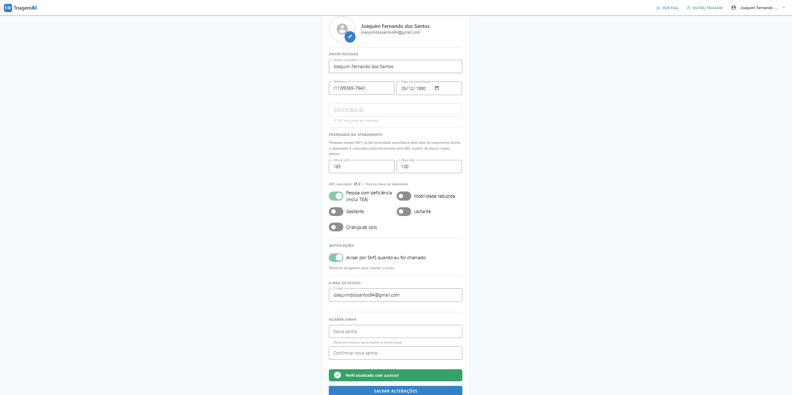
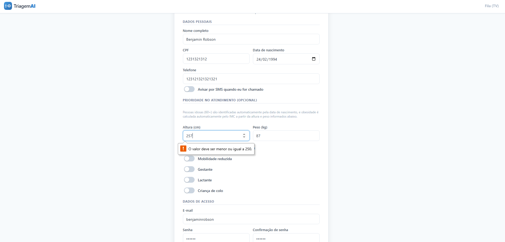
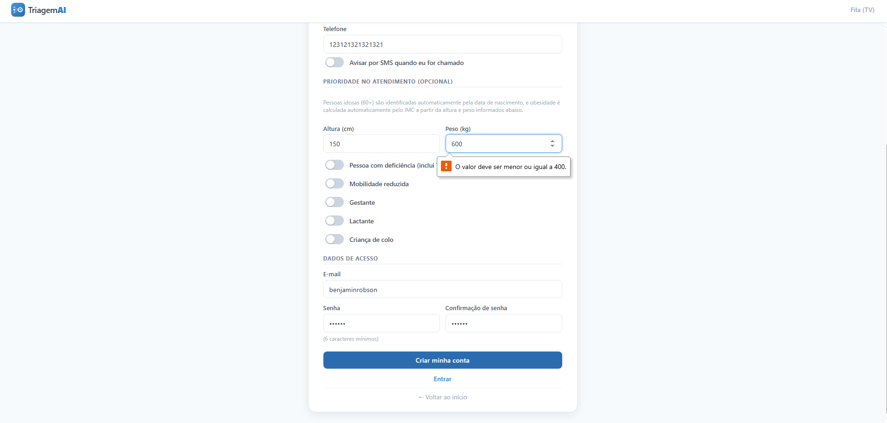
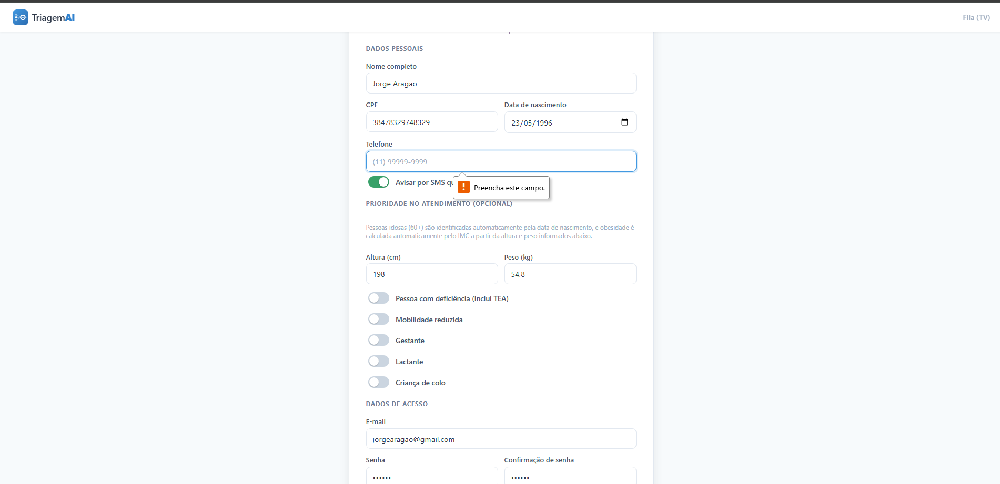

# UC03 – Atualizar perfil e prioridade legal

| Campo | Descrição |
|---|---|
| Ator(es) | Solicitante |
| Cenário de teste | Hospital (prioridade legal) |
| Pré-condições | Solicitante autenticado. |
| Pós-condição esperada | priority_reasons e priority_tier atualizados (0, 1 ou 2). |
| Componentes/rotas | Api::ProfileController; ProfileEdit.vue; User#priority_tier. |
| Resultado esperado | Perfil salvo e prioridade legal calculada conforme as regras. |
| Situação inicial | Executado manualmente em 10/11/2026 – ver registro e parecer abaixo |

## Registro da execução

| Data / executor | Versão / cenário | Resultado obtido / status |
|---|---|---|
| 10/11/2026 – Equipe TriagemAI (execução no navegador + suíte automatizada) | Branch ultimas-atualizacoes (commit 7ad705d); cenário Hospital (5 níveis, validação, check-in e revisão do especialista ativos) | Perfil carregado e atualizado via /api/profile; dados persistidos. Aprovado. |

## Fluxo principal – passos e evidências

UC03 – Passo 01: Abrir o perfil na aplicação.

Conferir: Campos de dados pessoais e condições de prioridade visíveis.

Figura A.3.1 – UC03, evidência do passo 01

Fonte: Captura de tela do TriagemAI (2026).

UC03 – Passo 02: Informar data de nascimento, altura, peso e telefone válidos.

Conferir: Formulário aceita dados dentro dos limites previstos.

Figura A.3.2 – UC03, evidência do passo 02

Fonte: Captura de tela do TriagemAI (2026).

UC03 – Passo 03: Informar condição de prioridade legal e eventual validade.

Conferir: Condição apresentada para revisão.

Figura A.3.3 – UC03, evidência do passo 03

Fonte: Captura de tela do TriagemAI (2026).

UC03 – Passo 04: Salvar e reabrir o perfil.

Conferir: Alterações persistidas e prioridade calculada corretamente.

Figura A.3.4 – UC03, evidência do passo 04

Fonte: Captura de tela do TriagemAI (2026).

## Fluxos alternativos e exceções – verificações obrigatórias

A01. Condição temporária sem validade ou já vencida deve ser recusada.

A02. Altura fora de 50–250 cm e peso fora de 1–400 kg devem ser recusados.

A03. Solicitação de SMS sem telefone deve ser recusada.

Figura A.3.A – UC03, evidências das exceções/alternativas

Fonte: Captura de tela do TriagemAI (2026).

## Resultado observado e parecer do caso de uso

| Campo | Resultado documentado |
|---|---|
| Resultado obtido | GET /api/profile retornou nome, contato, data de nascimento, CPF e foto; as alterações salvas reapareceram ao reabrir o perfil e as condições de prioridade passaram a compor o priority_tier. |
| Fluxos alternativos | A01: gestante sem validade recusada ("Validade da prioridade de gestante deve ser informada"); validade no passado recusada ("não pode ser uma data no passado"). A02: altura 300 cm recusada ("Altura (cm) deve ser menor que 250"); 40 cm, 0,5 kg e 500 kg também recusados. A03: aviso por SMS sem telefone recusado ("é obrigatório para ativar o aviso por SMS"). |
| Status final | [X] Aprovado   [ ] Aprovado com ressalva   [ ] Reprovado |
| Não conformidades | Nenhuma. |
| Evidências complementares | PATCH /api/profile retornando 422 com as mensagens acima; testes "UC03 A01/A02" e user_test (SMS). Suíte automatizada final: 111 testes, 261 asserções, 0 falhas (bin/rails test, 25/11/2026, tag tcc-final-2026-11-25). |
