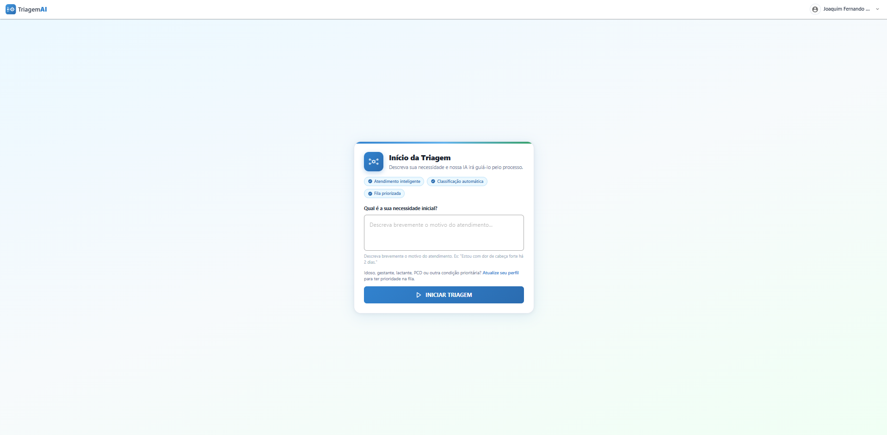
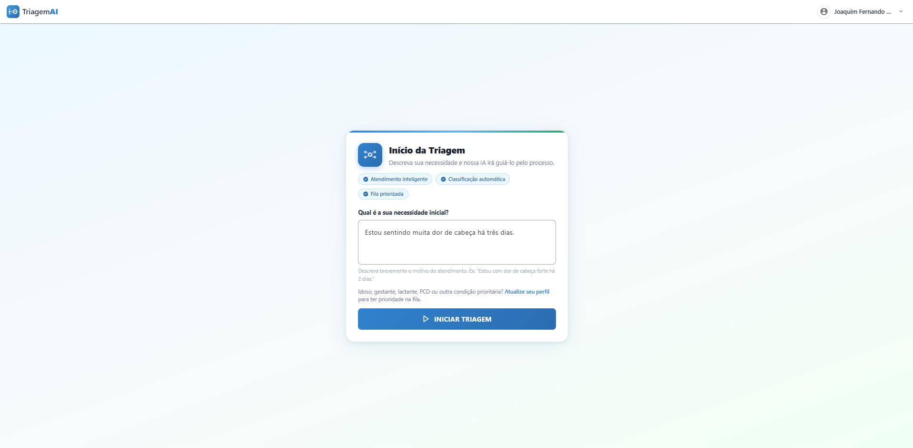
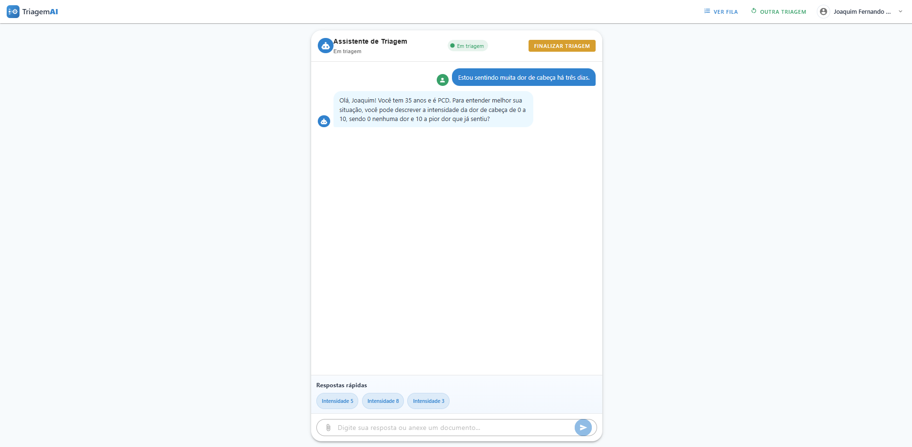
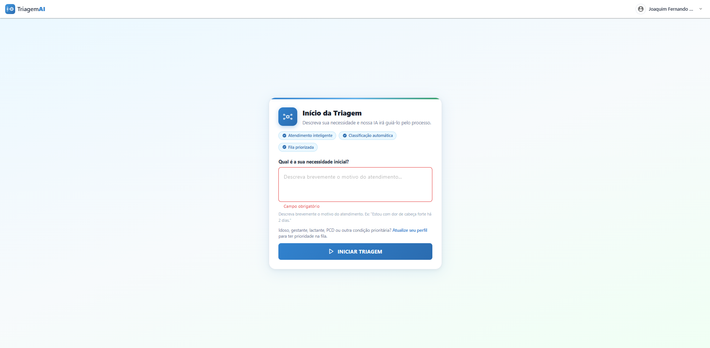
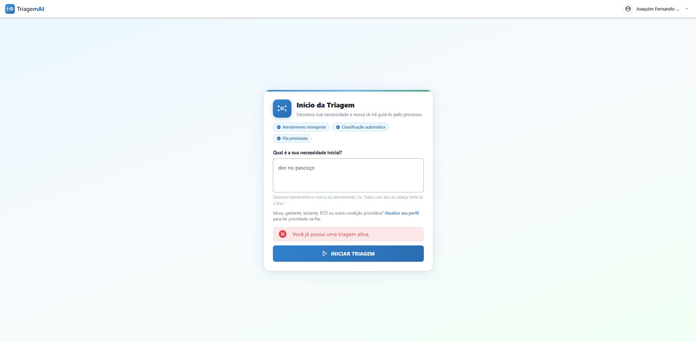

# UC04 – Iniciar triagem

| Campo | Descrição |
|---|---|
| Ator(es) | Solicitante |
| Cenário de teste | Hospital ou Secretaria |
| Pré-condições | Solicitante autenticado, sem triagem ativa. |
| Pós-condição esperada | TriageSession em in_triage, com primeira interação registrada. |
| Componentes/rotas | POST /api/triage/start; TriageSession. |
| Resultado esperado | Sessão criada exatamente uma vez, com mensagem e primeira pergunta. |
| Situação inicial | Executado manualmente em 10/11/2026 – ver registro e parecer abaixo |

## Registro da execução

| Data / executor | Versão / cenário | Resultado obtido / status |
|---|---|---|
| 10/11/2026 – Equipe TriagemAI (execução no navegador + suíte automatizada) | Branch ultimas-atualizacoes (commit 7ad705d); cenário Hospital (5 níveis, validação, check-in e revisão do especialista ativos) | Triagem 162 criada (status in_triage) e conduzida pela IA. Aprovado. |

## Fluxo principal – passos e evidências

UC04 – Passo 01: Entrar no app como solicitante e abrir a nova triagem.

Conferir: Tela inicial permite relatar o motivo.

Figura A.4.1 – UC04, evidência do passo 01

Fonte: Captura de tela do TriagemAI (2026).

UC04 – Passo 02: Informar a demanda inicial.

Conferir: Motivo preenchido e apto a envio.

Figura A.4.2 – UC04, evidência do passo 02

Fonte: Captura de tela do TriagemAI (2026).

UC04 – Passo 03: Acionar o início da triagem.

Conferir: Criação de uma única TriageSession em in_triage.

Figura A.4.3 – UC04, evidência do passo 03

Fonte: Captura de tela do TriagemAI (2026).

UC04 – Passo 04: Conferir a resposta inicial da IA e o histórico.

Conferir: Primeira pergunta e mensagem inicial registradas.

Figura A.4.4 – UC04, evidência do passo 04

Fonte: Captura de tela do TriagemAI (2026).

## Fluxos alternativos e exceções – verificações obrigatórias

A01. Motivo vazio deve produzir erro sem criar sessão.

A02. Solicitante com sessão ativa não pode iniciar outra triagem.

Fonte: Captura de tela do TriagemAI (2026).

| Campo | Resultado documentado |
|---|---|
| Resultado obtido | POST /api/triage/start com a demanda "Dor de garganta moderada há 2 dias, com febre baixa" criou a triagem 162 (HTTP 201, in_triage); a IA respondeu com pergunta de acompanhamento e sugestões de resposta. |
| Fluxos alternativos | A01: demanda vazia recusada (HTTP 422, "Informe o motivo inicial do atendimento."). A02: segunda triagem com uma ativa recusada (HTTP 422, "Você já possui uma triagem ativa."). |
| Status final | [X] Aprovado   [ ] Aprovado com ressalva   [ ] Reprovado |
| Não conformidades | Nenhuma. |
| Evidências complementares | Triagem 162, paciente de teste, 10/11/2026 14:45. Suíte automatizada final: 111 testes, 261 asserções, 0 falhas (bin/rails test, 25/11/2026, tag tcc-final-2026-11-25). |
