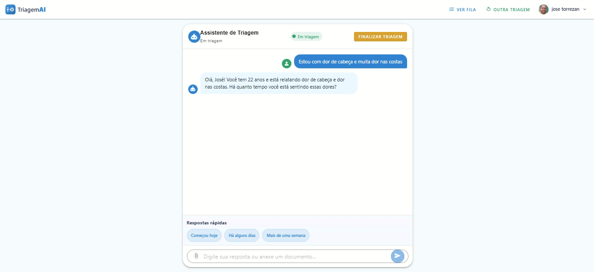
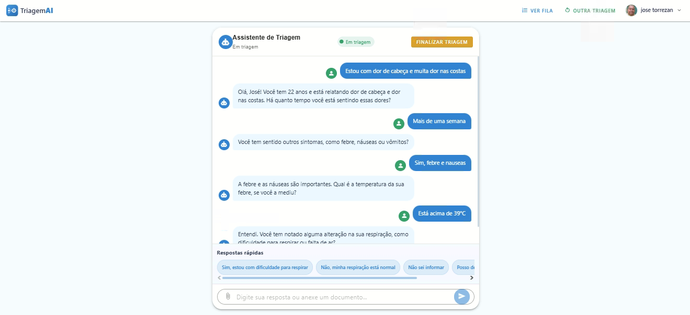
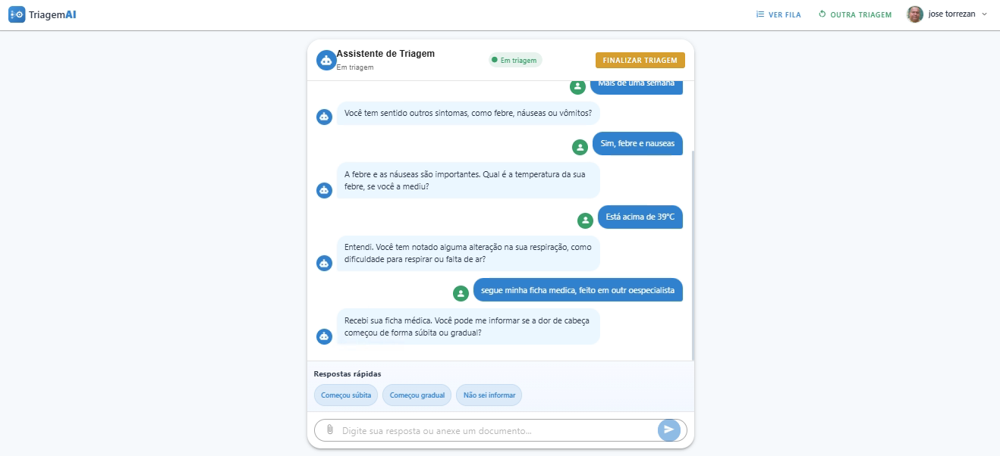
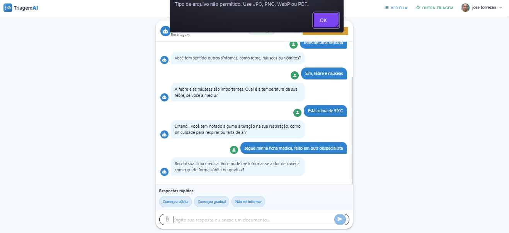

# UC05 – Conversar com a IA (com ou sem documento)

| Campo | Descrição |
|---|---|
| Ator(es) | Solicitante; IA |
| Cenário de teste | Hospital (mensagens); Secretaria (anexos) |
| Pré-condições | TriageSession em in_triage. |
| Pós-condição esperada | Mensagens e anexos associados à sessão. |
| Componentes/rotas | POST /api/triage/message; TriageService#process_message; AiService; DocumentValidatorService; TriageChannel. |
| Resultado esperado | Conversa persistida, respostas geradas e anexos tratados sem perda de estado. |
| Situação inicial | Executado manualmente em 10/11/2026 – ver registro e parecer abaixo |

## Registro da execução

| Data / executor | Versão / cenário | Resultado obtido / status |
|---|---|---|
| 10/11/2026 – Equipe TriagemAI (execução no navegador + suíte automatizada) | Branch ultimas-atualizacoes (commit 7ad705d); cenário Hospital (5 níveis, validação, check-in e revisão do especialista ativos) | Mensagens gravadas no histórico e respondidas pela IA. Aprovado com ressalva. |

## Fluxo principal – passos e evidências

UC05 – Passo 01: Abrir o chat da triagem.

Conferir: Histórico da sessão correto.

Figura A.5.1 – UC05, evidência do passo 01

Fonte: Captura de tela do TriagemAI (2026).

UC05 – Passo 02: Enviar uma mensagem que descreva a demanda.

Conferir: Mensagem persistida e atualizada em tempo real.

Figura A.5.2 – UC05, evidência do passo 02

Fonte: Captura de tela do TriagemAI (2026).

UC05 – Passo 03: Conferir a nova pergunta e sugestões da IA.

Conferir: Resposta pertinente exibida e salva no histórico.

Figura A.5.3 – UC05, evidência do passo 03

Fonte: Captura de tela do TriagemAI (2026).

UC05 – Passo 04: Anexar uma imagem de documento em cenário habilitado.

Conferir: Anexo associado; status de análise válido, inválido ou incerto.

Figura A.5.4 – UC05, evidência do passo 04

Fonte: Captura de tela do TriagemAI (2026).

## Fluxos alternativos e exceções – verificações obrigatórias

A01. Arquivo ilegível deve produzir aviso sem destruir a sessão.

Figura A.5.A – UC05, evidências das exceções/alternativas

Fonte: Captura de tela do TriagemAI (2026).

## Resultado observado e parecer do caso de uso

| Campo | Resultado documentado |
|---|---|
| Resultado obtido | Duas mensagens enviadas (HTTP 200); cada resposta da IA ficou gravada em /api/triage/messages com sugestões de resposta rápida, sem encerrar a triagem antes da hora. |
| Fluxos alternativos | Mensagem vazia recusada (HTTP 422, "Mensagem vazia."). Encerramento pela IA reconhecido pelo campo finished (testes de AiService). Passo 04 e teste de anexo ilegível: não comprovados individualmente nesta rodada. |
| Status final | [ ] Aprovado   [X] Aprovado com ressalva   [ ] Reprovado |
| Não conformidades | Anexo de documento e reação a arquivo ilegível (passo 04/A01) não têm resultado específico nas evidências analisadas. |
| Evidências complementares | Histórico da triagem 162; testes ai_service_test (parse_chat_reply / triage_finished?). Suíte automatizada final: 111 testes, 261 asserções, 0 falhas (bin/rails test, 25/11/2026, tag tcc-final-2026-11-25). Parecer com ressalva quanto à cobertura documental/aderência da alternativa. |
