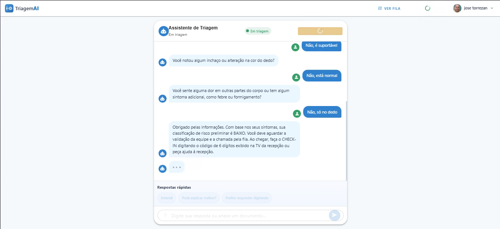
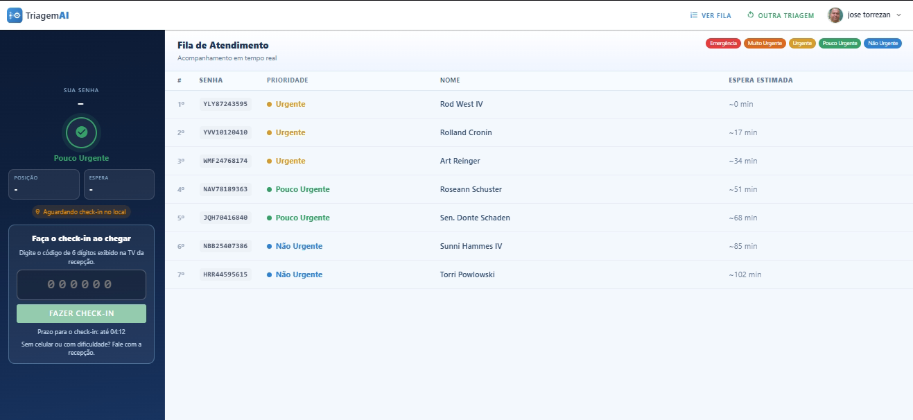
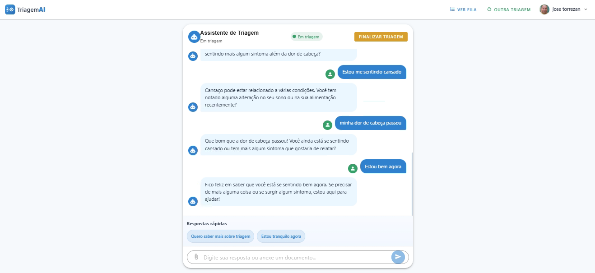

# UC06 – Encerrar triagem e gerar classificação

| Campo | Descrição |
|---|---|
| Ator(es) | Solicitante; IA |
| Cenário de teste | Hospital e Secretaria, com configurações diferentes |
| Pré-condições | Sessão em in_triage. |
| Pós-condição esperada | AiClassification registrada; transição condicional de estado. |
| Componentes/rotas | POST /api/triage/finish; TriageService#finalize_triage; AiClassification. |
| Resultado esperado | Classificação persistida e encaminhamento ao estado exigido no cenário. |
| Situação inicial | Executado manualmente em 10/11/2026 – ver registro e parecer abaixo |

## Registro da execução

| Data / executor | Versão / cenário | Resultado obtido / status |
|---|---|---|
| 10/11/2026 – Equipe TriagemAI (execução no navegador + suíte automatizada) | Branch ultimas-atualizacoes (commit 7ad705d); cenário Hospital (5 níveis, validação, check-in e revisão do especialista ativos) | Triagem finalizada, classificada como Urgente e enviada para check-in. Aprovado com ressalva. |

## Fluxo principal – passos e evidências

UC06 – Passo 01: Concluir as respostas da conversa.

Conferir: Informações necessárias disponíveis no histórico.

Figura A.6.1 – UC06, evidência do passo 01

Fonte: Captura de tela do TriagemAI (2026).

UC06 – Passo 02: Acionar Encerrar triagem ou aguardar marcador de término da IA.

Conferir: Solicitação de finalização processada.

Figura A.6.2 – UC06, evidência do passo 02

Fonte: Captura de tela do TriagemAI (2026).

UC06 – Passo 03: Conferir urgência, resumo e justificativa gerados.

Conferir: Classificação estruturada registrada sem sobrescrever mensagens.

Figura A.6.3 – UC06, evidência do passo 03

Fonte: Captura de tela do TriagemAI (2026).

## Fluxos alternativos e exceções – verificações obrigatórias

A01. Falha de finalização não deve encerrar indevidamente a sessão.

Figura A.6.A – UC06, evidências das exceções/alternativas

Fonte: Captura de tela do TriagemAI (2026).

## Resultado observado e parecer do caso de uso

| Campo | Resultado documentado |
|---|---|
| Resultado obtido | POST /api/triage/finish classificou a triagem 162 como Urgente, com resumo e sinais identificados, e mudou o status para awaiting_checkin com prazo de check-in. |
| Fluxos alternativos | Finalizar uma triagem que já não está ativa: recusado (HTTP 422, "Triagem não está ativa."). Emergência pula o check-in e segue direto para validação (testes de TriageService). Falha real durante finalização com manutenção da sessão: não demonstrada. |
| Status final | [ ] Aprovado   [X] Aprovado com ressalva   [ ] Reprovado |
| Não conformidades | A01 exige demonstrar falha de finalização mantendo a sessão ativa; o registro apresentado cobre apenas sessão já inativa. |
| Evidências complementares | Triagem 162 (Urgente) e 163 (torção de tornozelo, Urgente). Suíte automatizada final: 111 testes, 261 asserções, 0 falhas (bin/rails test, 25/11/2026, tag tcc-final-2026-11-25). Parecer com ressalva quanto à cobertura documental/aderência da alternativa. |
