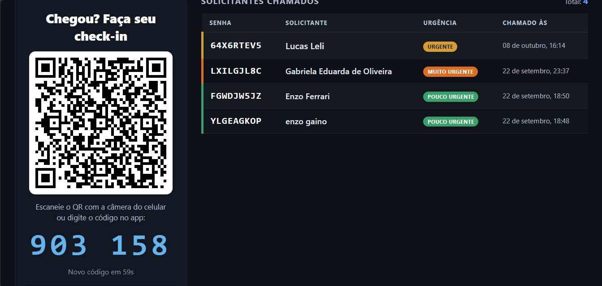
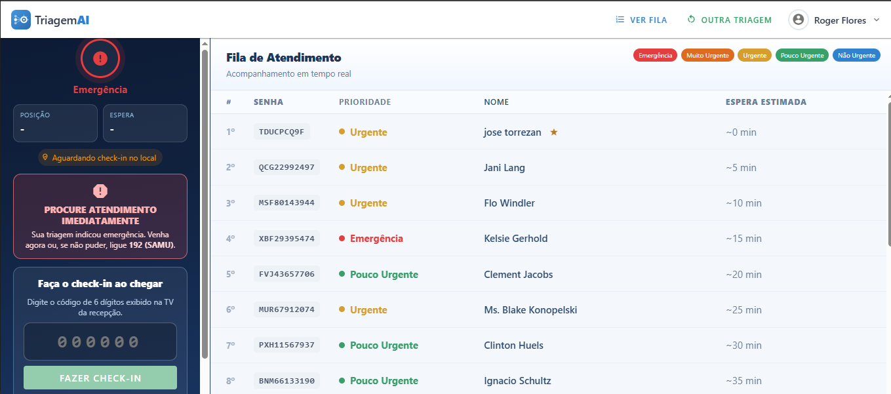
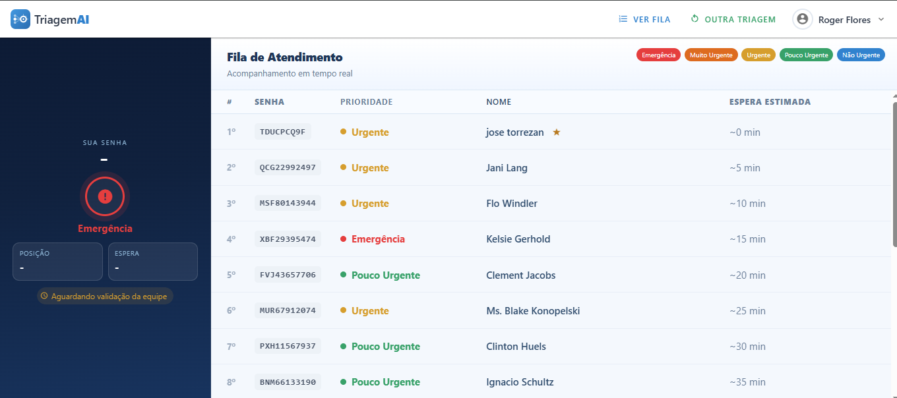
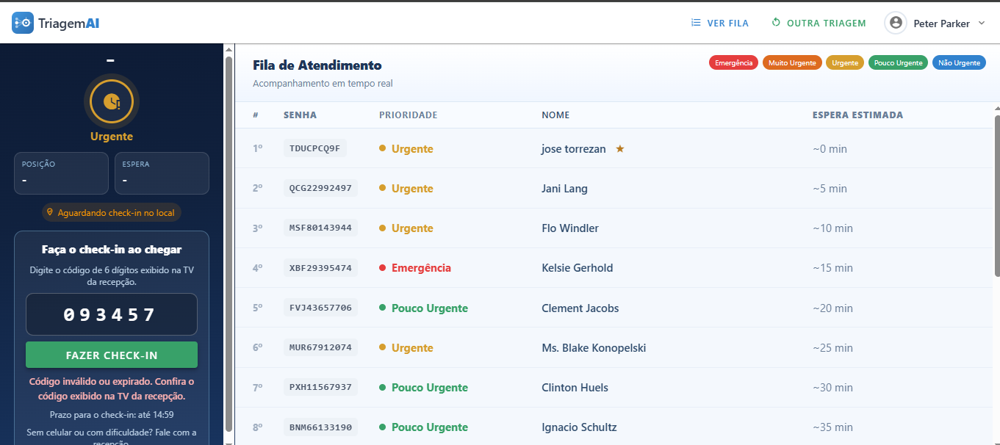
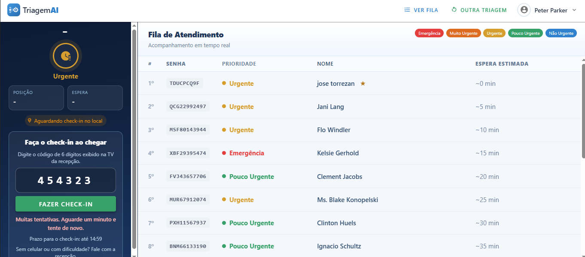

# UC07 – Check-in pelo código da TV

| Campo | Descrição |
|---|---|
| Ator(es) | Solicitante |
| Cenário de teste | Hospital com require_checkin habilitado |
| Pré-condições | Sessão em awaiting_checkin e TV da recepção com código rotativo de seis dígitos. |
| Pós-condição esperada | checked_in_at preenchido, sessão avança para validação ou fila. |
| Componentes/rotas | POST /api/triage/checkin; CheckinCode; TriageService#check_in!; ExpirePendingCheckinsJob. |
| Resultado esperado | Check-in registrado uma vez e entrada no próximo estado previsto. |
| Situação inicial | Executado manualmente em 10/11/2026 – ver registro e parecer abaixo |

## Registro da execução

| Data / executor | Versão / cenário | Resultado obtido / status |
|---|---|---|
| 10/11/2026 – Equipe TriagemAI (execução no navegador + suíte automatizada) | Branch ultimas-atualizacoes (commit 7ad705d); cenário Hospital (5 níveis, validação, check-in e revisão do especialista ativos) | Check-in pelo código da TV levou a triagem 163 para validação. Aprovado com ressalva. |

## Fluxo principal – passos e evidências

UC07 – Passo 01: Exibir a TV pública ativada e identificar o código atual.

Conferir: Código de seis dígitos ou QR code visível.

Figura A.7.1 – UC07, evidência do passo 01

Fonte: Captura de tela do TriagemAI (2026).

UC07 – Passo 02: Abrir a solicitação de check-in no app.

Conferir: Campo de código ou leitor QR apresentado.

Figura A.7.2 – UC07, evidência do passo 02

Fonte: Captura de tela do TriagemAI (2026).

UC07 – Passo 03: Informar o código válido dentro do prazo.

Conferir: Check-in aceito e horário registrado.

Figura A.7.3 – UC07, evidência do passo 03

Fonte: Captura de tela do TriagemAI (2026).

## Fluxos alternativos e exceções – verificações obrigatórias

A01. Código incorreto ou vencido (cerca de três minutos) deve ser recusado.

A02. Mais de cinco tentativas por minuto devem ser bloqueadas.

Figura A.7.A – UC07, evidências das exceções/alternativas

Fonte: Captura de tela do TriagemAI (2026).

## Resultado observado e parecer do caso de uso

| Campo | Resultado documentado |
|---|---|
| Resultado obtido | Com a TV autorizada (POST /tv/activate), o código rotativo de 6 dígitos foi lido em /tv/checkin_code e digitado no app; a triagem 163 passou de awaiting_checkin para awaiting_validation. |
| Fluxos alternativos | Código errado recusado (HTTP 422), triagem permanece aguardando check-in. TV não autorizada não recebe o código (HTTP 403). Código antigo/expirado recusado e triagem sem check-in expira no prazo (testes checkin_code e checkin_flow). A02 (mais de cinco tentativas/minuto): sem registro isolado do resultado. |
| Status final | [ ] Aprovado   [X] Aprovado com ressalva   [ ] Reprovado |
| Não conformidades | O registro principal documenta código válido; não há evidência individual vinculada ao bloqueio após mais de cinco tentativas por minuto (A02). |
| Evidências complementares | Triagem 163, 10/11/2026 14:51; TV desativada ao final do teste. Suíte automatizada final: 111 testes, 261 asserções, 0 falhas (bin/rails test, 25/11/2026, tag tcc-final-2026-11-25). Parecer com ressalva quanto à cobertura documental/aderência da alternativa. |
