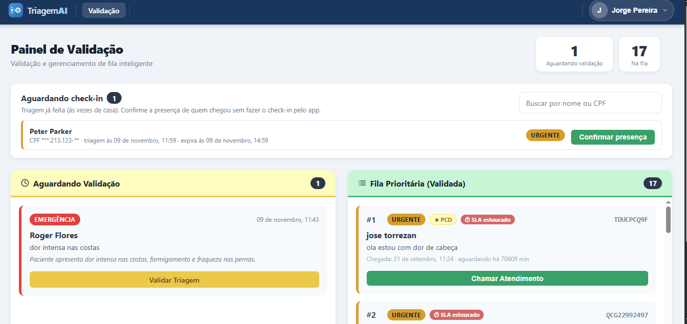
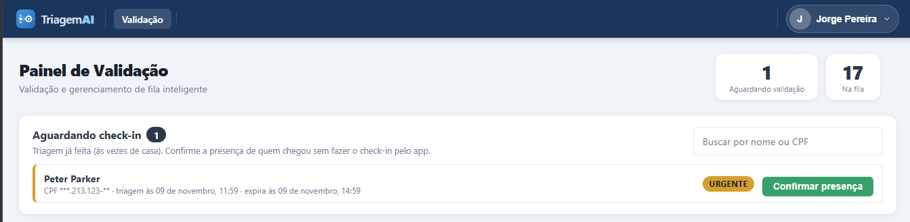
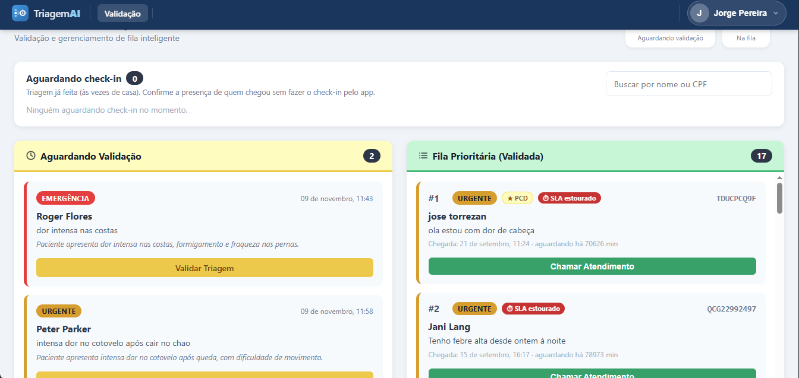
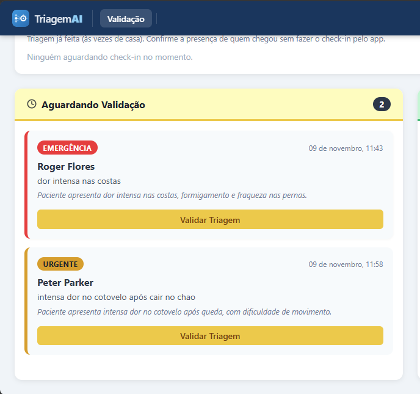
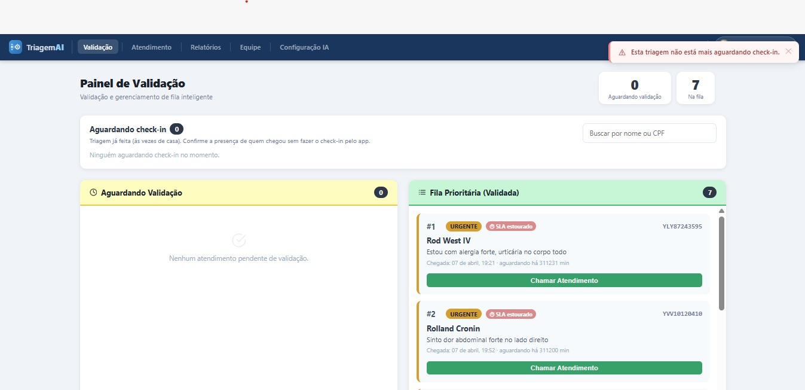

# UC08 – Check-in pela recepção

| Campo | Descrição |
|---|---|
| Ator(es) | Colaborador |
| Cenário de teste | Hospital com check-in presencial |
| Pré-condições | Colaborador autenticado; sessão em awaiting_checkin. |
| Pós-condição esperada | checked_in_at e estado de sessão atualizados. |
| Componentes/rotas | POST /validation/triage_sessions/:id/check_in; Validation::CheckinsController. |
| Resultado esperado | Registro único da presença e mudança de estado. |
| Situação inicial | Executado manualmente em 10/11/2026 – ver registro e parecer abaixo |

## Registro da execução

| Data / executor | Versão / cenário | Resultado obtido / status |
|---|---|---|
| 10/11/2026 – Equipe TriagemAI (execução no navegador + suíte automatizada) | Branch ultimas-atualizacoes (commit 7ad705d); cenário Hospital (5 níveis, validação, check-in e revisão do especialista ativos) | Recepção confirmou a presença e a triagem foi para validação. Aprovado. |

## Fluxo principal – passos e evidências

UC08 – Passo 01: Entrar no painel da equipe.

Conferir: Colaborador autenticado e seção de check-in disponível.

Figura A.8.1 – UC08, evidência do passo 01

Fonte: Captura de tela do TriagemAI (2026).

UC08 – Passo 02: Localizar a sessão aguardando check-in.

Conferir: Solicitante e status correspondentes.

Figura A.8.2 – UC08, evidência do passo 02

Fonte: Captura de tela do TriagemAI (2026).

UC08 – Passo 03: Confirmar presença pela recepção.

Conferir: Horário de check-in registrado.

Figura A.8.3 – UC08, evidência do passo 03

Fonte: Captura de tela do TriagemAI (2026).

UC08 – Passo 04: Conferir próximo estado e painel.

Conferir: Transição para validação ou fila sem duplicidade.

Figura A.8.4 – UC08, evidência do passo 04

Fonte: Captura de tela do TriagemAI (2026).

## Fluxos alternativos e exceções – verificações obrigatórias

A01. Sessão já confirmada ou expirada não deve aceitar novo check-in.

Figura A.8.A – UC08, evidências das exceções/alternativas

Fonte: Captura de tela do TriagemAI (2026).

## Resultado observado e parecer do caso de uso

| Campo | Resultado documentado |
|---|---|
| Resultado obtido | No painel /validation, o botão de check-in da recepção confirmou a presença ("Check-in de … confirmado.") e a triagem 162 passou para awaiting_validation; a etapa aparece no histórico com o nome de quem fez. |
| Fluxos alternativos | Triagem que não está mais aguardando check-in: recusada com "Esta triagem não está mais aguardando check-in." Check-in duplo (app e recepção) não enfileira duas vezes (teste). |
| Status final | [X] Aprovado   [ ] Aprovado com ressalva   [ ] Reprovado |
| Não conformidades | Nenhuma. |
| Evidências complementares | Histórico do atendimento 56: "Check-in no local – Presença confirmada pela recepção". Suíte automatizada final: 111 testes, 261 asserções, 0 falhas (bin/rails test, 25/11/2026, tag tcc-final-2026-11-25). |
