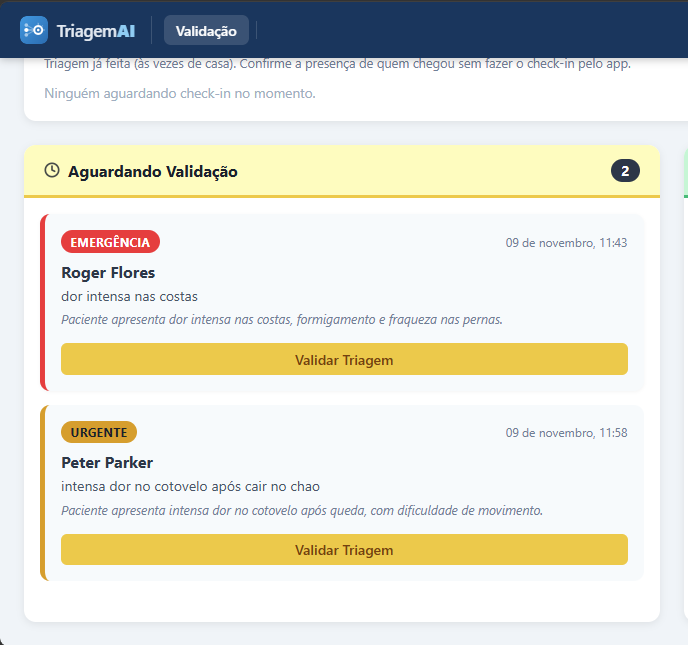
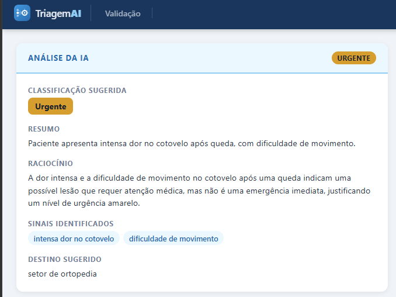
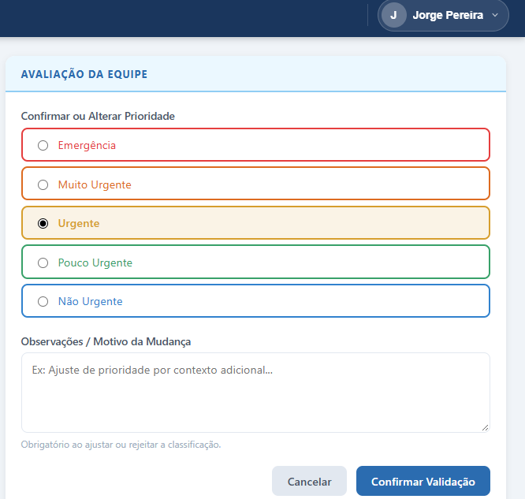
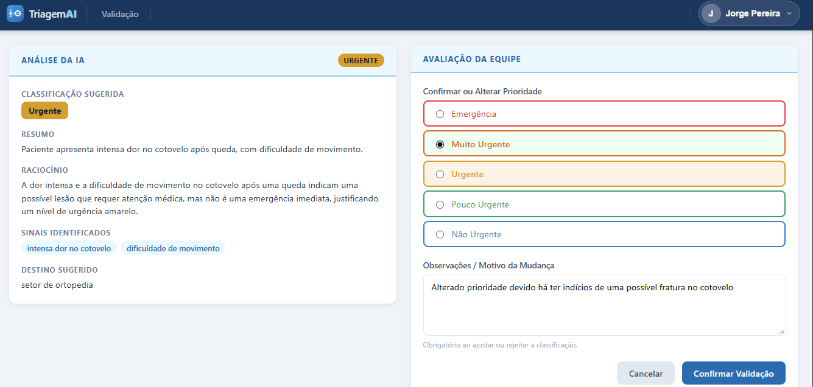
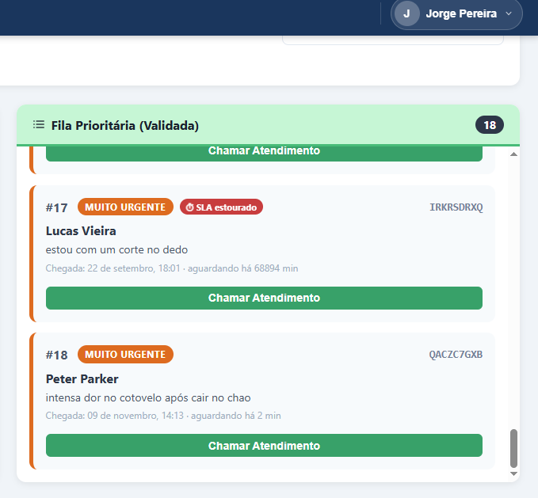
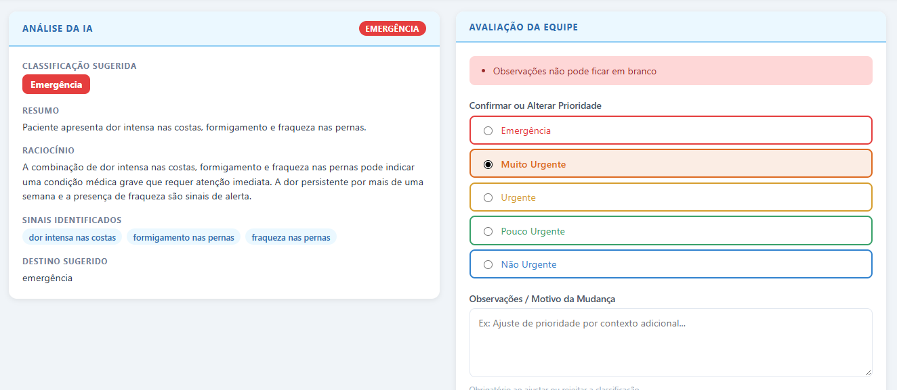
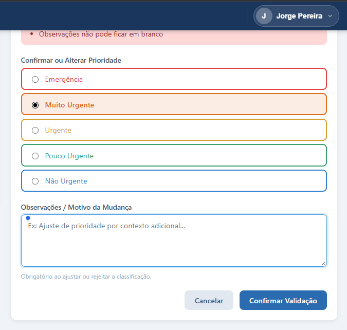

# UC09 – Validar a classificação da IA

| Campo | Descrição |
|---|---|
| Ator(es) | Colaborador |
| Cenário de teste | Hospital com require_staff_validation ligado |
| Pré-condições | Validação humana habilitada; sessão em awaiting_validation. |
| Pós-condição esperada | TriageValidation criada, urgência final preservando sugestão original. |
| Componentes/rotas | Validation::TriageValidationsController; TriageValidation; ValidationPanelChannel. |
| Resultado esperado | Confirmação ou ajuste persistido sem apagar a sugestão original da IA. |
| Situação inicial | Executado manualmente em 10/11/2026 – ver registro e parecer abaixo |

## Registro da execução

| Data / executor | Versão / cenário | Resultado obtido / status |
|---|---|---|
| 10/11/2026 – Equipe TriagemAI (execução no navegador + suíte automatizada) | Branch ultimas-atualizacoes (commit 7ad705d); cenário Hospital (5 níveis, validação, check-in e revisão do especialista ativos) | Classificação ajustada de Urgente para Pouco Urgente com observação; triagem entrou na fila. Aprovado após correção. |

## Fluxo principal – passos e evidências

UC09 – Passo 01: Abrir a lista de triagens aguardando validação.

Conferir: Sessão aparece em awaiting_validation.

Figura A.9.1 – UC09, evidência do passo 01

Fonte: Captura de tela do TriagemAI (2026).

UC09 – Passo 02: Consultar resumo, urgência sugerida, justificativa e conversa.

Conferir: Informações originais da IA apresentadas.

Figura A.9.2 – UC09, evidência do passo 02

Fonte: Captura de tela do TriagemAI (2026).

UC09 – Passo 03: Confirmar o nível ou escolher um nível diferente.

Conferir: Decisão permitida conforme a configuração atual.

Figura A.9.3 – UC09, evidência do passo 03

Fonte: Captura de tela do TriagemAI (2026).

UC09 – Passo 04: Se houver ajuste, preencher justificativa e salvar.

Conferir: TriageValidation separada da AiClassification.

Figura A.9.4 – UC09, evidência do passo 04

Fonte: Captura de tela do TriagemAI (2026).

UC09 – Passo 05: Verificar encaminhamento e histórico de decisão.

Conferir: Urgência final registrada e sessão liberada para fila.

Figura A.9.5 – UC09, evidência do passo 05

Fonte: Captura de tela do TriagemAI (2026).

## Fluxos alternativos e exceções – verificações obrigatórias

A01. Ajuste sem justificativa deve ser recusado.

A02. Conferir que a sugestão original da IA permanece registrada e consultável após o ajuste da urgência pelo colaborador.

Figura A.9.A – UC09, evidências das exceções/alternativas

Fonte: Captura de tela do TriagemAI (2026).

## Resultado observado e parecer do caso de uso

| Campo | Resultado documentado |
|---|---|
| Resultado obtido | O colaborador abriu a análise da IA (nível sugerido, resumo, raciocínio, sinais e destino), alterou para Pouco Urgente com observação e confirmou; a validação foi gravada como "ajustada" e a triagem entrou na fila (senha U1YYEP86V). |
| Fluxos alternativos | Ajuste sem observação recusado ("Observações não pode ficar em branco"), inclusive quando o formulário é adulterado para enviar "confirmado". Nível inexistente recusado ("não está configurado no painel da IA"). Confirmar sem alterar não exige observação. Segunda validação da mesma triagem bloqueada com aviso. |
| Status final | [X] Aprovado   [ ] Aprovado com ressalva   [ ] Reprovado |
| Não conformidades | Encontradas e corrigidas durante o teste: (1) a decisão vinha de um campo oculto do formulário, e um envio "confirmado" com nível alterado era aceito; agora o servidor calcula a decisão. (2) Validar duas vezes a mesma triagem gerava erro 500; agora há bloqueio com mensagem. Reteste aprovado. |
| Evidências complementares | Triagem 162 / atendimento 56: histórico "Ajustou de Urgente para Pouco Urgente". Testes "UC09" (4). Suíte automatizada final: 111 testes, 261 asserções, 0 falhas (bin/rails test, 25/11/2026, tag tcc-final-2026-11-25). |
