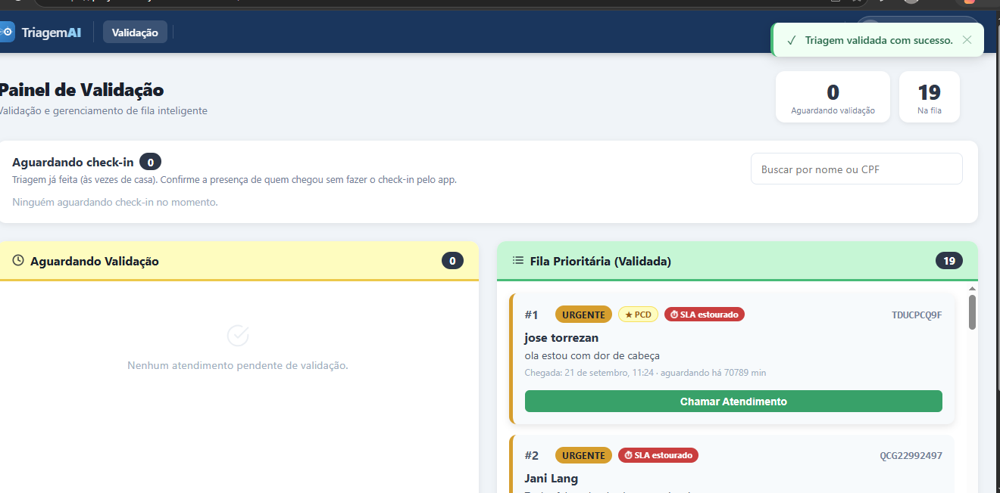
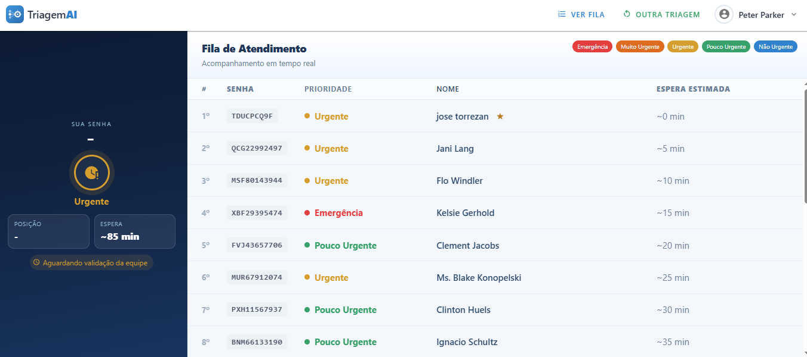
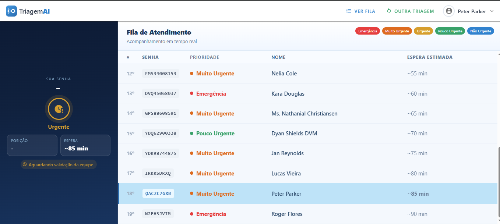
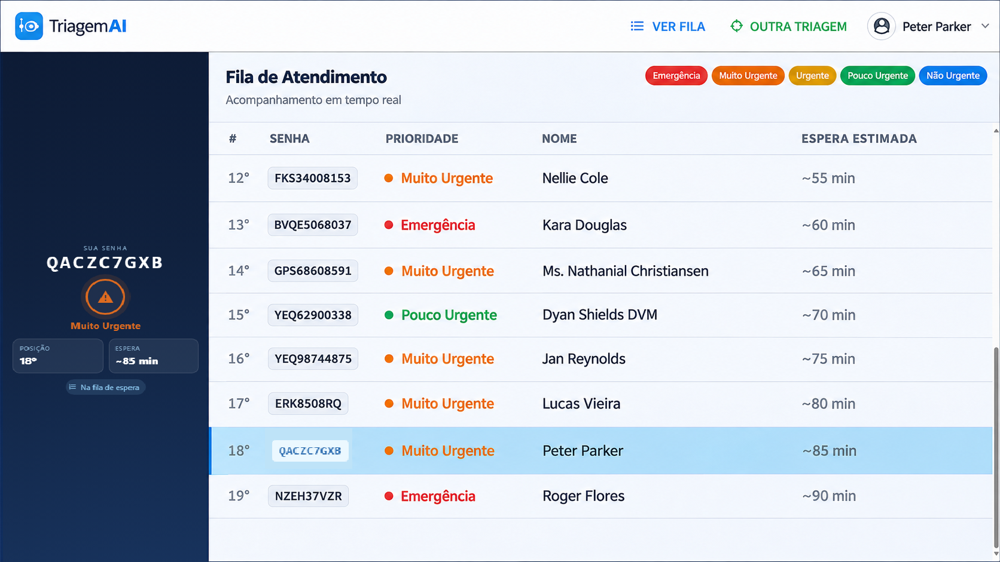

# UC10 – Entrar na fila e receber senha

| Campo | Descrição |
|---|---|
| Ator(es) | Sistema |
| Cenário de teste | Hospital ou Secretaria |
| Pré-condições | Triagem validada, ou diretamente classificada quando a validação está desabilitada. |
| Pós-condição esperada | QueueEntry waiting, queued_at e sessão in_queue. |
| Componentes/rotas | QueueEntryService#enqueue; QueueEntry; Notification. |
| Resultado esperado | Entrada única e consistente, senha e notificação registradas. |
| Situação inicial | Executado manualmente em 10/11/2026 – ver registro e parecer abaixo |

## Registro da execução

| Data / executor | Versão / cenário | Resultado obtido / status |
|---|---|---|
| 10/11/2026 – Equipe TriagemAI (execução no navegador + suíte automatizada) | Branch ultimas-atualizacoes (commit 7ad705d); cenário Hospital (5 níveis, validação, check-in e revisão do especialista ativos) | Senha U1YYEP86V gerada com urgência validada e posição na fila. Aprovado. |

## Fluxo principal – passos e evidências

UC10 – Passo 01: Preparar sessão elegível para entrada na fila.

Conferir: Validação concluída ou desabilitada na configuração.

Figura A.10.1 – UC10, evidência do passo 01

Fonte: Captura de tela do TriagemAI (2026).

UC10 – Passo 02: Concluir a etapa que libera a entrada.

Conferir: Serviço de enfileiramento acionado.

Figura A.10.2 – UC10, evidência do passo 02

Fonte: Captura de tela do TriagemAI (2026).

UC10 – Passo 03: Conferir senha exibida ao solicitante.

Conferir: Senha única com nove caracteres.

Figura A.10.3 – UC10, evidência do passo 03

Fonte: Captura de tela do TriagemAI (2026).

UC10 – Passo 04: Conferir status, horário e prioridade de entrada.

Conferir: Fila com peso/prioridade registrados.

Figura A.10.4 – UC10, evidência do passo 04

Fonte: Captura de tela do TriagemAI (2026).

UC10 – Passo 05: Verificar atualização visual da fila.

Conferir: Fila e notificação correspondente.

Figura A.10.5 – UC10, evidência do passo 05

Fonte: Captura de tela do TriagemAI (2026).

## Resultado observado e parecer do caso de uso

| Campo | Resultado documentado |
|---|---|
| Resultado obtido | Após a validação, o QueueEntryService gerou a senha U1YYEP86V com urgência Pouco Urgente (nível final da equipe), registrou a entrada na fila e o painel passou a exibi-la na posição calculada. |
| Fluxos alternativos | Sem validação humana, a triagem entra na fila com a urgência da IA (teste). A prioridade legal é gravada como snapshot no momento da entrada (priority_tier 0 neste caso). |
| Status final | [X] Aprovado   [ ] Aprovado com ressalva   [ ] Reprovado |
| Não conformidades | Nenhuma. |
| Evidências complementares | Atendimento 56 (senha U1YYEP86V). Testes de TriageService e QueueEntry. Suíte automatizada final: 111 testes, 261 asserções, 0 falhas (bin/rails test, 25/11/2026, tag tcc-final-2026-11-25). |
