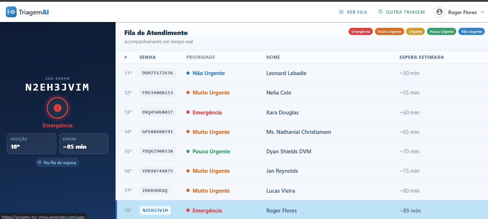
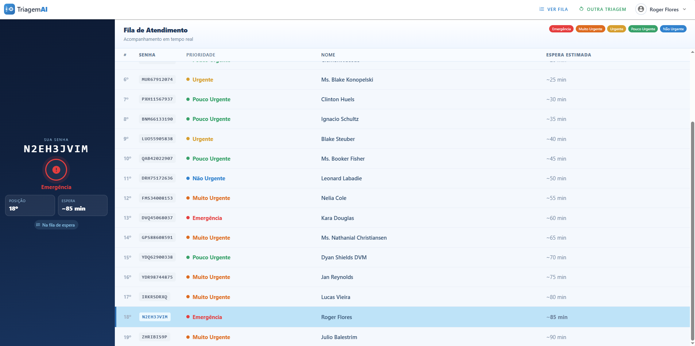
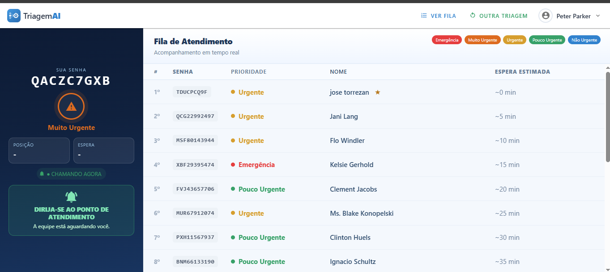

# UC11 – Acompanhar posição e tempo de espera

| Campo | Descrição |
|---|---|
| Ator(es) | Solicitante |
| Cenário de teste | Hospital ou Secretaria |
| Pré-condições | QueueEntry em waiting. |
| Pós-condição esperada | Solicitante informado sem recarga manual. |
| Componentes/rotas | GET /api/queue; QueueChannel; TriageQueue.vue; QueueEntry#queue_position. |
| Resultado esperado | Acompanhamento consistente e em tempo real. |
| Situação inicial | Executado manualmente em 10/11/2026 – ver registro e parecer abaixo |

## Registro da execução

| Data / executor | Versão / cenário | Resultado obtido / status |
|---|---|---|
| 10/11/2026 – Equipe TriagemAI (execução no navegador + suíte automatizada) | Branch ultimas-atualizacoes (commit 7ad705d); cenário Hospital (5 níveis, validação, check-in e revisão do especialista ativos) | Paciente acompanha senha, status e fila geral com tempo estimado. Aprovado com ressalva após correção. |

## Fluxo principal – passos e evidências

UC11 – Passo 01: Abrir a tela de fila no app.

Conferir: Senha, urgência e motivos de prioridade visíveis.

Figura A.11.1 – UC11, evidência do passo 01

Fonte: Captura de tela do TriagemAI (2026).

UC11 – Passo 02: Conferir posição e estimativa de espera.

Conferir: Posição coerente com a fila atual; estimativa visível.

Figura A.11.2 – UC11, evidência do passo 02

Fonte: Captura de tela do TriagemAI (2026).

UC11 – Passo 03: Alterar uma entrada de teste na fila por outro perfil.

Conferir: Tela do solicitante atualiza automaticamente.

Figura A.11.3 – UC11, evidência do passo 03

Fonte: Captura de tela do TriagemAI (2026).

UC11 – Passo 04: Chamar a senha do solicitante.

Conferir: Tela passa a apresentar informação da chamada.

Figura A.11.4 – UC11, evidência do passo 04

Fonte: Captura de tela do TriagemAI (2026).

## Fluxos alternativos e exceções – verificações obrigatórias

A01. Com histórico, utiliza média dos últimos 50 atendimentos, mínimo cinco minutos.

A02. Na chamada, os dados devem refletir novo estado e posição.

Figura A.11.A – UC11, evidências das exceções/alternativas

A01

Fonte: Captura de tela do TriagemAI (2026).

## Resultado observado e parecer do caso de uso

| Campo | Resultado documentado |
|---|---|
| Resultado obtido | /api/triage/status mostrou senha, urgência e status (chamado → em atendimento); /api/queue listou a fila ordenada com posição e espera estimada (0, 17 e 34 min nas primeiras posições). |
| Fluxos alternativos | Mudanças de posição e chamada são enviadas pelo QueueChannel (eventos queued, position_update e called), e o app recarrega a fila. Média dos últimos 50 e piso de 5 min: não demonstrados separadamente. |
| Status final | [ ] Aprovado   [X] Aprovado com ressalva   [ ] Reprovado |
| Não conformidades | A alternativa com média dos últimos 50 atendimentos e piso de cinco minutos não está demonstrada por resultado segregado; houve correção do filtro de atendimentos longos. |
| Evidências complementares | Teste "average_service_minutes ignores attendances left open for days". Suíte automatizada final: 111 testes, 261 asserções, 0 falhas (bin/rails test, 25/11/2026, tag tcc-final-2026-11-25). Parecer com ressalva quanto à cobertura documental/aderência da alternativa. |
