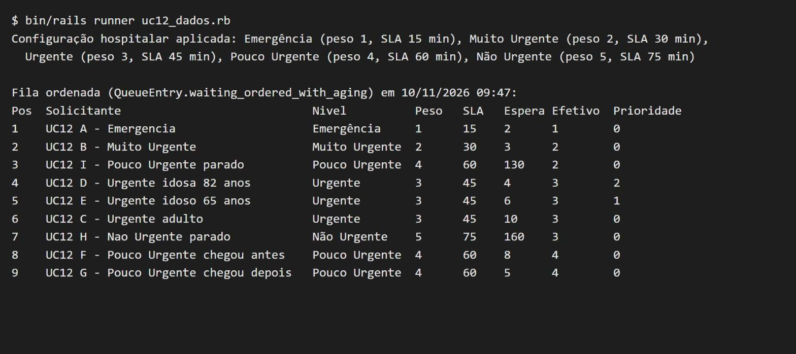
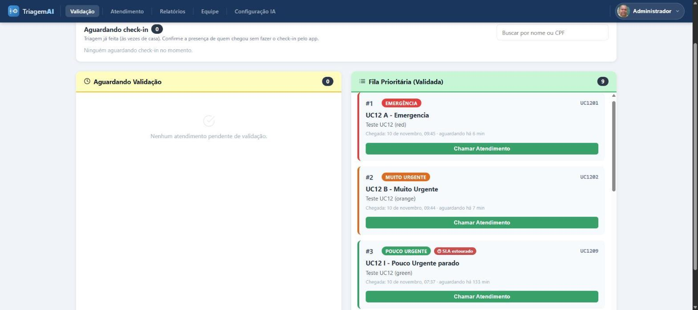
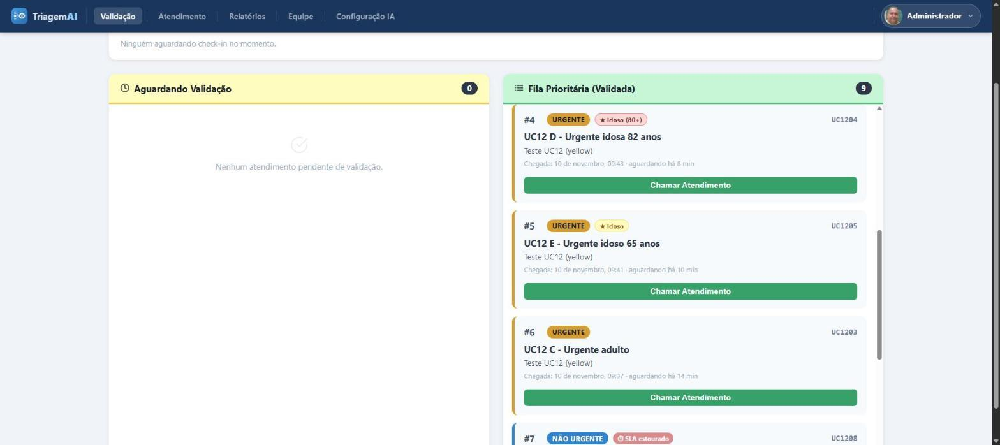
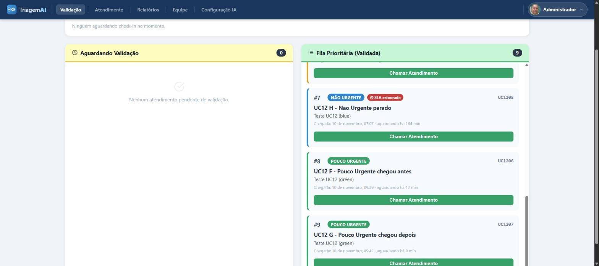
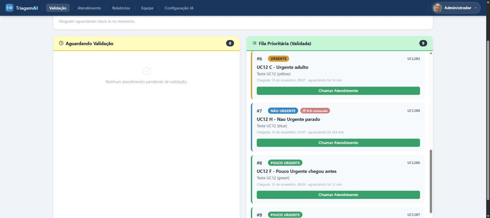
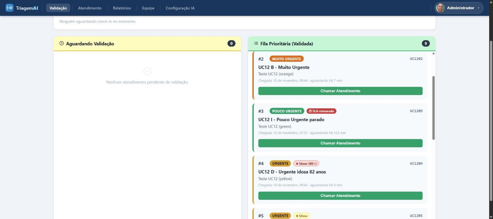

# UC12 – Ordenar a fila (urgência, prioridade legal e SLA)

| Campo | Descrição |
|---|---|
| Ator(es) | Sistema |
| Cenário de teste | Hospital com dados controlados |
| Pré-condições | Duas ou mais QueueEntry em waiting. |
| Pós-condição esperada | Ordenação consistente nas diferentes interfaces. |
| Componentes/rotas | QueueEntry.waiting_ordered_with_aging; effective_urgency_weight; sla_breached?. |
| Resultado esperado | Fila ordenada por peso efetivo, prioridade legal e tempo, com envelhecimento. |
| Situação inicial | Executado manualmente em 10/11/2026 – ver registro e parecer abaixo |

## Registro da execução

| Data / executor | Versão / cenário | Resultado obtido / status |
|---|---|---|
| 10/11/2026 – Equipe TriagemAI (execução no navegador + suíte automatizada) | Branch ultimas-atualizacoes (commit 7ad705d); cenário Hospital (5 níveis, validação, check-in e revisão do especialista ativos) | Ordenação por urgência, prioridade legal, chegada e SLA conferida. Aprovado. |

## Fluxo principal – passos e evidências

UC12 – Passo 01: Cadastrar múltiplas entradas de teste com urgências diferentes.

Conferir: Pesos e registros iniciais conferidos.

Figura A.12.1 – UC12, evidência do passo 01

Fonte: Captura de tela do TriagemAI (2026).

UC12 – Passo 02: Verificar a ordenação entre urgências.

Conferir: Menor peso efetivo aparece antes.

Figura A.12.2 – UC12, evidência do passo 02

Fonte: Captura de tela do TriagemAI (2026).

UC12 – Passo 03: Empatar urgências e variar prioridade legal.

Conferir: Prioridade legal maior aparece primeiro.

Figura A.12.3 – UC12, evidência do passo 03

Fonte: Captura de tela do TriagemAI (2026).

UC12 – Passo 04: Empatar urgência e prioridade legal.

Conferir: Entrada mais antiga aparece primeiro.

Figura A.12.4 – UC12, evidência do passo 04

Fonte: Captura de tela do TriagemAI (2026).

UC12 – Passo 05: Simular janela de SLA vencida e conferir a lista.

Conferir: Envelhecimento melhora peso efetivo sem alterar urgência registrada.

Figura A.12.5 – UC12, evidência do passo 05

Fonte: Captura de tela do TriagemAI (2026).

## Fluxos alternativos e exceções – verificações obrigatórias

A01. Idoso de 80+ (nível 2) deve passar nível 1 dentro da mesma urgência.

A02. A cada janela completa de SLA, melhorar peso efetivo até limite superior.

A03. Nenhuma transição de SLA pode modificar a classificação original.

Figura A.12.A – UC12, evidências das exceções/alternativas

Fonte: Captura de tela do TriagemAI (2026).

## Resultado observado e parecer do caso de uso

| Campo | Resultado documentado |
|---|---|
| Resultado obtido | Com as entradas de teste UC12 A–F, a fila seguiu urgência efetiva > urgência original > prioridade legal > chegada: emergência no topo, idosa 80+ à frente dentro do mesmo nível e caso envelhecido subindo um nível por janela de SLA (capturas das Figuras A.12). |
| Fluxos alternativos | A01: idoso 80+ (nível 2) passa à frente do nível 1 na mesma urgência. A02: a cada janela completa de SLA o peso efetivo melhora até o limite. A03: o envelhecimento não altera a classificação original e não ultrapassa quem é daquele nível de verdade (testes de desempate). |
| Status final | [X] Aprovado   [ ] Aprovado com ressalva   [ ] Reprovado |
| Não conformidades | Nenhuma. |
| Evidências complementares | Entradas UC1201–UC1206; queue_entry_test (8 testes de ordenação e SLA). Suíte automatizada final: 111 testes, 261 asserções, 0 falhas (bin/rails test, 25/11/2026, tag tcc-final-2026-11-25). |
