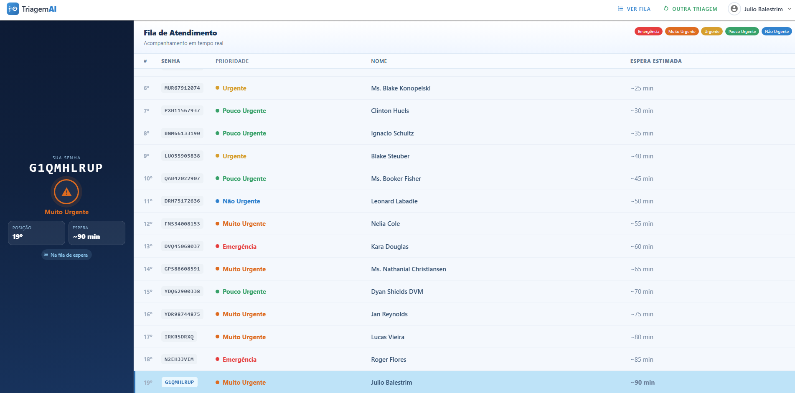
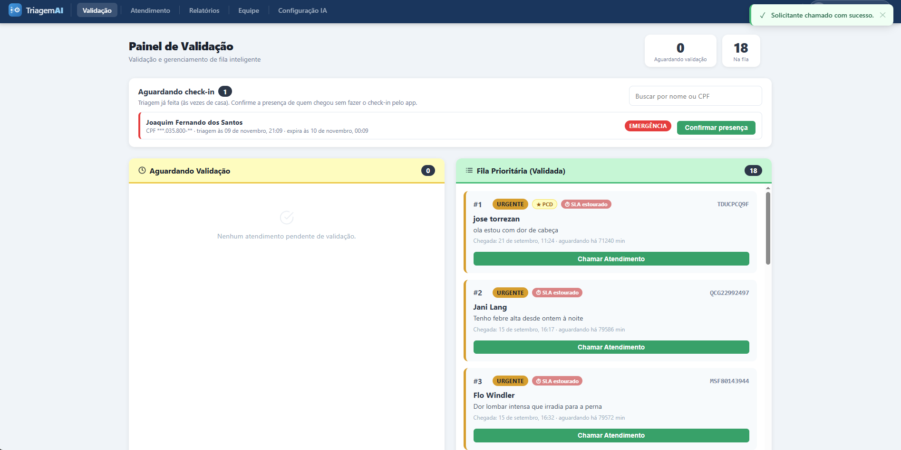
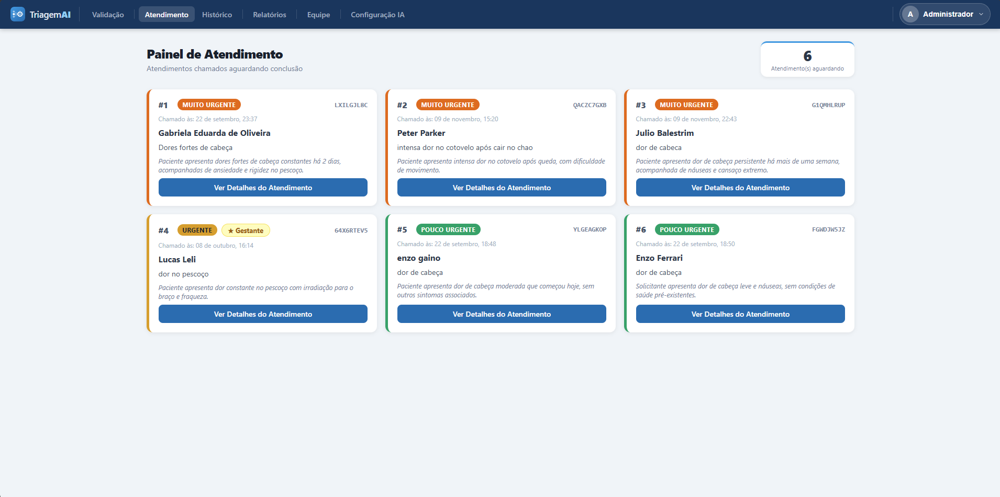
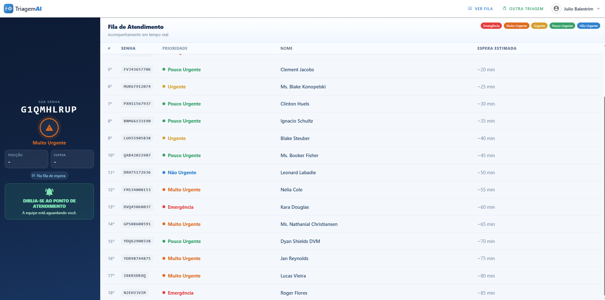
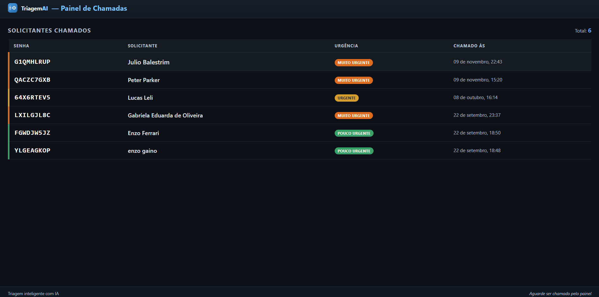
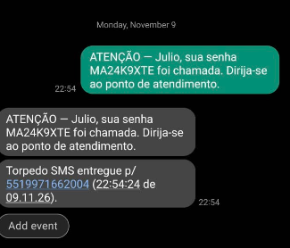

# UC13 – Chamar o solicitante

| Campo | Descrição |
|---|---|
| Ator(es) | Colaborador |
| Cenário de teste | Hospital ou Secretaria |
| Pré-condições | Entrada em waiting. |
| Pós-condição esperada | Entrada called e called_at; canais atualizados. |
| Componentes/rotas | PATCH /validation/queue_entries/:id/call; QueueChannel; TvChannel; SmsNotifierService; TvController. |
| Resultado esperado | Chamada única com atualização dos canais. |
| Situação inicial | Executado manualmente em 10/11/2026 – ver registro e parecer abaixo |

## Registro da execução

| Data / executor | Versão / cenário | Resultado obtido / status |
|---|---|---|
| 10/11/2026 – Equipe TriagemAI (execução no navegador + suíte automatizada) | Branch ultimas-atualizacoes (commit 7ad705d); cenário Hospital (5 níveis, validação, check-in e revisão do especialista ativos) | Paciente chamado e retirado da fila de espera. Aprovado com ressalva. |

## Fluxo principal – passos e evidências

UC13 – Passo 01: Abrir painel de fila com uma senha em espera.

Conferir: Entrada identificada.

Figura A.13.1 – UC13, evidência do passo 01

Fonte: Captura de tela do TriagemAI (2026).

UC13 – Passo 02: Selecionar chamar próxima senha.

Conferir: Operação de chamada aceita.

Figura A.13.2 – UC13, evidência do passo 02

Fonte: Captura de tela do TriagemAI (2026).

UC13 – Passo 03: Conferir status e horário no painel.

Conferir: Status e horário no painel.

Figura A.13.3 – UC13, evidência do passo 03

Fonte: Captura de tela do TriagemAI (2026).

UC13 – Passo 04: Conferir app e TV pública.

Conferir: Chamada refletida nos canais em tempo real.

Figura A.13.4 – UC13, evidência do passo 04

Fonte: Captura de tela do TriagemAI (2026).

UC13 – Passo 05: Se SMS habilitado, verificar o disparo.

Conferir: Aviso enviado ao contato configurado; log quando necessário.

Figura A.13.5 – UC13, evidência do passo 05

Fonte: Captura de tela do TriagemAI (2026).

## Resultado observado e parecer do caso de uso

| Campo | Resultado documentado |
|---|---|
| Resultado obtido | Em /validation, "Chamar" mudou a entrada 56 para chamado ("Solicitante chamado com sucesso."), registrou quem chamou e o paciente passou a ver o status de chamado no app. |
| Fluxos alternativos | Chamar uma entrada que não está mais na espera: recusado com "Atendimento não está na fila de espera." Disparo de SMS: sem evidência individual anexada. |
| Status final | [ ] Aprovado   [X] Aprovado com ressalva   [ ] Reprovado |
| Não conformidades | O disparo de SMS previsto no passo 05 não foi demonstrado por registro de entrega ou log específico. |
| Evidências complementares | Histórico do atendimento 56: "Paciente chamado". Suíte automatizada final: 111 testes, 261 asserções, 0 falhas (bin/rails test, 25/11/2026, tag tcc-final-2026-11-25). Parecer com ressalva quanto à cobertura documental/aderência da alternativa. |
