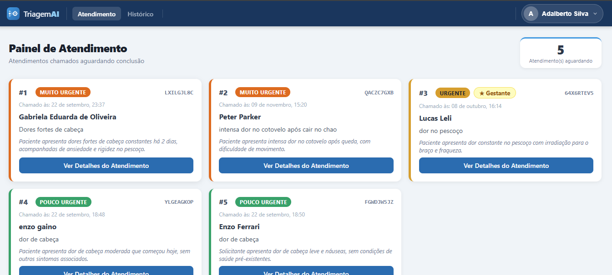
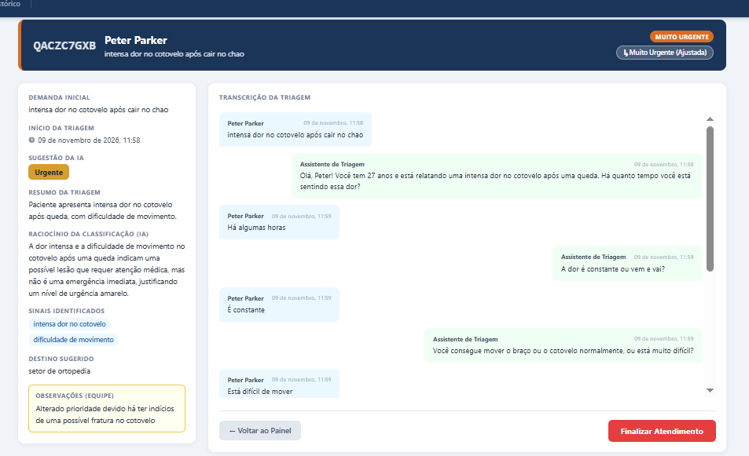
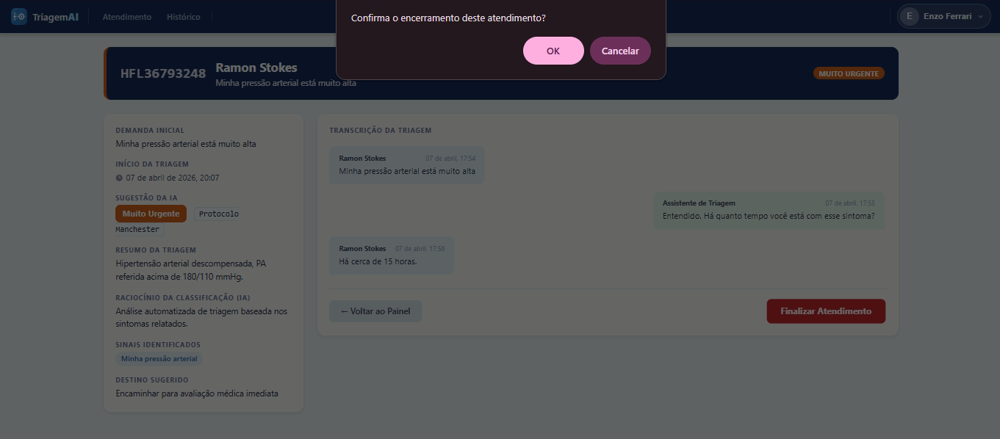
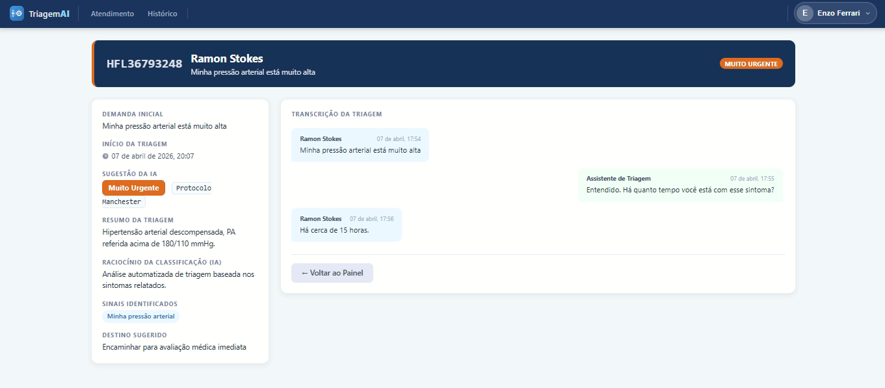
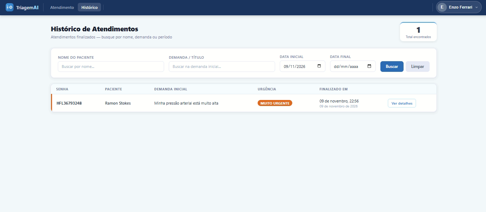

# UC14 – Atender e finalizar

| Campo | Descrição |
|---|---|
| Ator(es) | Especialista |
| Cenário de teste | Hospital ou Secretaria |
| Pré-condições | Fila com entrada chamada; especialista autenticado. |
| Pós-condição esperada | Sessão completed, service_finished_at preenchido, histórico retido. |
| Componentes/rotas | Attendance::AttendancesController#finish; Attendance::HistoryController. |
| Resultado esperado | Conclusão persistida e atendimento rastreável. |
| Situação inicial | Executado manualmente em 10/11/2026 – ver registro e parecer abaixo |

## Registro da execução

| Data / executor | Versão / cenário | Resultado obtido / status |
|---|---|---|
| 10/11/2026 – Equipe TriagemAI (execução no navegador + suíte automatizada) | Branch ultimas-atualizacoes (commit 7ad705d); cenário Hospital (5 níveis, validação, check-in e revisão do especialista ativos) | Atendimento finalizado e registrado no histórico. Aprovado. |

## Fluxo principal – passos e evidências

UC14 – Passo 01: Entrar no painel de atendimento como especialista.

Conferir: Entrada chamada disponível.

Figura A.14.1 – UC14, evidência do passo 01

Fonte: Captura de tela do TriagemAI (2026).

UC14 – Passo 02: Abrir o atendimento e consultar resumo, prioridade e histórico.

Conferir: Dados e mensagens acessíveis.

Figura A.14.2 – UC14, evidência do passo 02

Fonte: Captura de tela do TriagemAI (2026).

UC14 – Passo 03: Examinar anexos e observações, se existentes.

Conferir: Contexto suficiente para conduzir atendimento.

Figura A.14.3 – UC14, evidência do passo 03

Fonte: Captura de tela do TriagemAI (2026).

UC14 – Passo 04: Registrar a conclusão e acionar Finalizar.

Conferir: Conclusão salva e operação aceita.

Figura A.14.4 – UC14, evidência do passo 04

Fonte: Captura de tela do TriagemAI (2026).

UC14 – Passo 05: Reabrir o histórico e conferir o status.

Conferir: Histórico preenchido.

Figura A.14.5 – UC14, evidência do passo 05

Fonte: Captura de tela do TriagemAI (2026).

## Fluxos alternativos e exceções – verificações obrigatórias

A01. O atendimento concluído deve permanecer consultável no histórico.

Figura A.14.A – UC14, evidências das exceções/alternativas

Fonte: Captura de tela do TriagemAI (2026).

## Resultado observado e parecer do caso de uso

| Campo | Resultado documentado |
|---|---|
| Resultado obtido | Em /attendance/attendances/56 o histórico mostrou as 6 etapas com responsáveis; "Finalizar" concluiu o atendimento ("Atendimento finalizado."), que passou a constar em /attendance/history; o paciente ficou liberado para nova triagem. |
| Fluxos alternativos | Depois de finalizado, a ação de finalizar não é mais oferecida. Quem participou do atendimento não pode ser excluído (testes de equipe). |
| Status final | [X] Aprovado   [ ] Aprovado com ressalva   [ ] Reprovado |
| Não conformidades | Nenhuma. |
| Evidências complementares | Atendimento 56 / senha U1YYEP86V; testes attendance_history_and_reports. Suíte automatizada final: 111 testes, 261 asserções, 0 falhas (bin/rails test, 25/11/2026, tag tcc-final-2026-11-25). |
