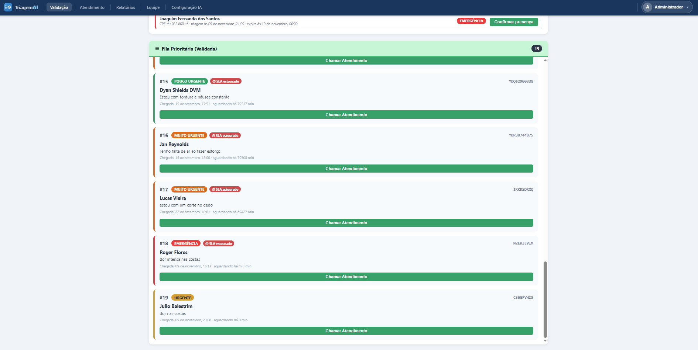
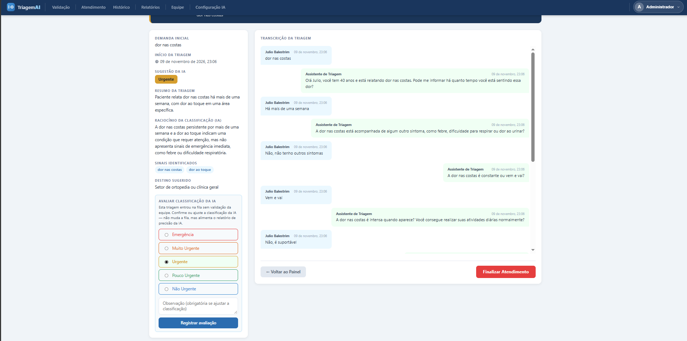
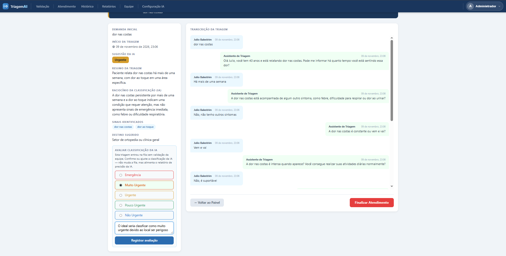
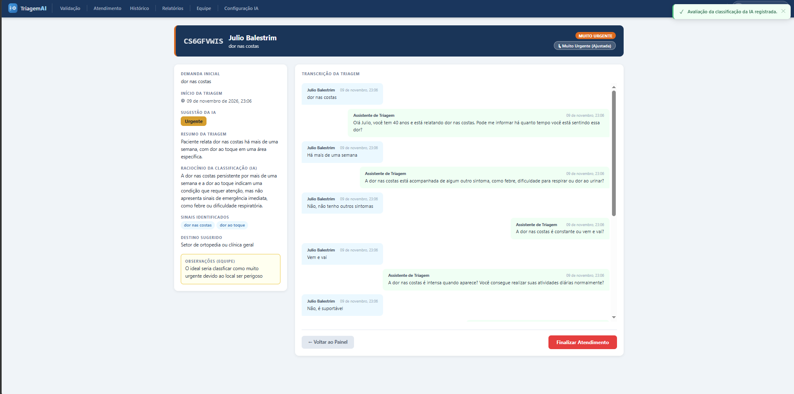
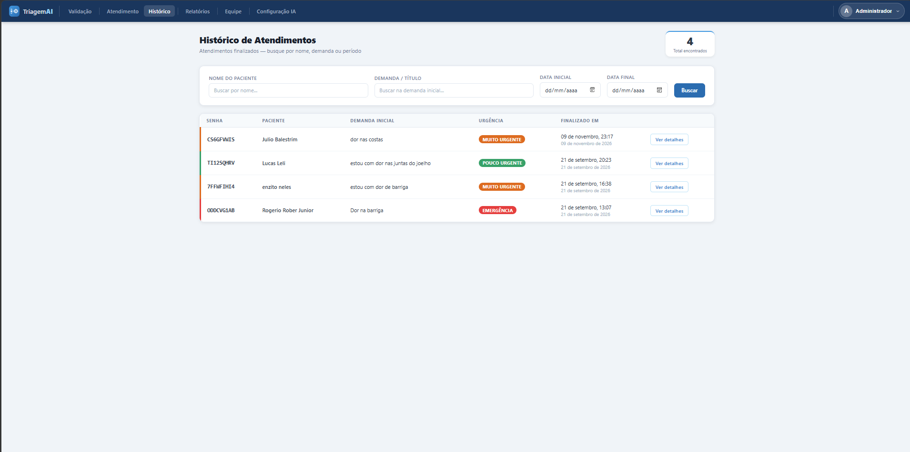
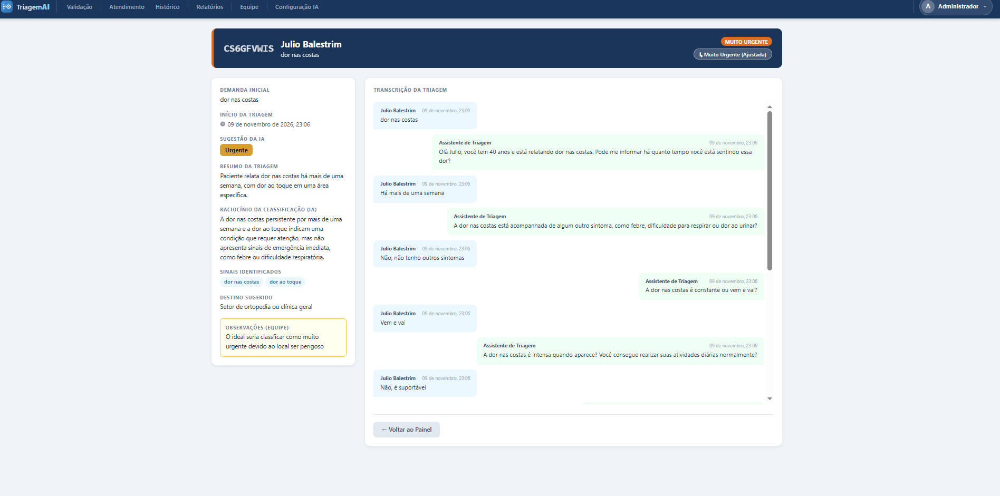
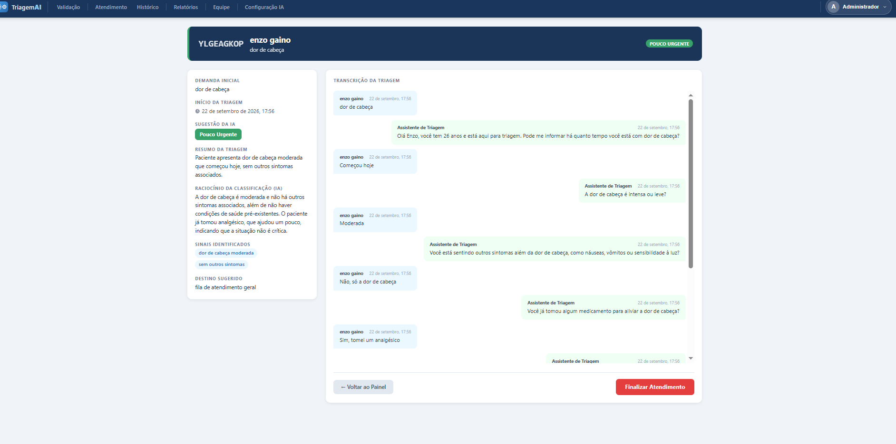
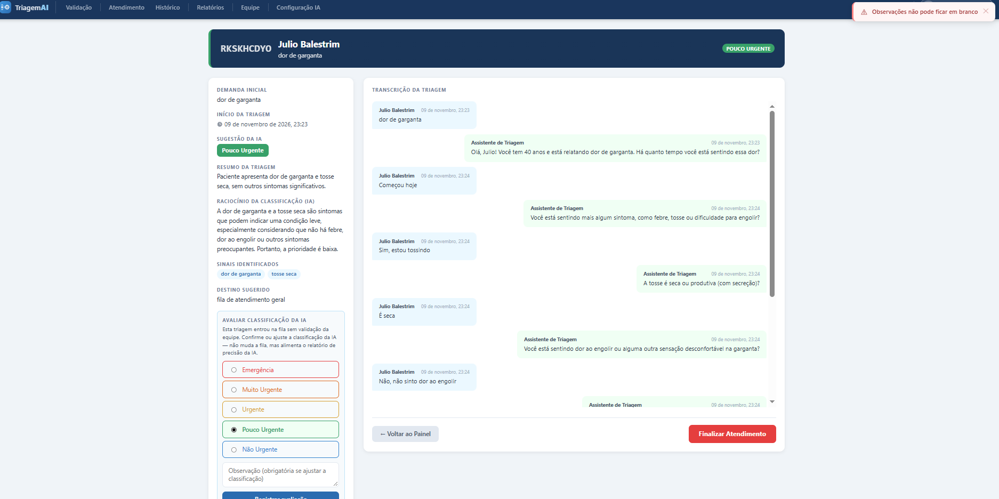

# UC15 – Revisar classificação durante atendimento

| Campo | Descrição |
|---|---|
| Ator(es) | Especialista |
| Cenário de teste | Secretaria com specialist_review_enabled ligado |
| Pré-condições | Revisão habilitada e triagem sem validação prévia da equipe. |
| Pós-condição esperada | TriageValidation de revisão, sem mudança de posição da fila. |
| Componentes/rotas | POST /attendance/attendances/:id/review_classification; TriageSetting#specialist_review_enabled. |
| Resultado esperado | Revisão persistida sem afetar atendimento já chamado. |
| Situação inicial | Executado manualmente em 10/11/2026 – ver registro e parecer abaixo |

## Registro da execução

| Data / executor | Versão / cenário | Resultado obtido / status |
|---|---|---|
| 10/11/2026 – Equipe TriagemAI (execução no navegador + suíte automatizada) | Branch ultimas-atualizacoes (commit 7ad705d); revisão habilitada e validação humana desligada em testes automatizados (cenário compatível com Secretaria); não há registro de execução manual integral nesse cenário. | Lógica de revisão registrada nos testes automatizados; cenário de execução manual inconsistente. Aprovado com ressalva. |

## Fluxo principal – passos e evidências

UC15 – Passo 01: Preparar triagem classificada e enfileirada sem validação humana.

Conferir: Registro possui sugestão da IA, sem validação de colaborador.

Figura A.15.1 – UC15, evidência do passo 01

Fonte: Captura de tela do TriagemAI (2026).

UC15 – Passo 02: Abrir atendimento chamado e localizar revisão da classificação.

Conferir: Controle de revisão habilitado.

Figura A.15.2 – UC15, evidência do passo 02

Fonte: Captura de tela do TriagemAI (2026).

UC15 – Passo 03: Confirmar urgência ou selecionar novo nível.

Conferir: Decisão de avaliação preenchida.

Figura A.15.3 – UC15, evidência do passo 03

Fonte: Captura de tela do TriagemAI (2026).

UC15 – Passo 04: Salvar revisão e consultar registro.

Conferir: TriageValidation de especialista criada.

Figura A.15.4 – UC15, evidência do passo 04

Fonte: Captura de tela do TriagemAI (2026).

UC15 – Passo 05: Verificar relatório relacionado.

Conferido: a validação gravada pela revisão do especialista entra no indicador “Concordância IA × equipe” de /validation/reports, que considera todas as validações do período. Verificado pelo teste “specialist review feeds the AI × team agreement indicator in the report” (25/11/2026): uma revisão com ajuste de nível resultou em 0,0% de concordância e 1 subtriagem no relatório.

Figura A.15.5 – UC15, evidência do passo 05

Fonte: Captura de tela do TriagemAI (2026).

## Fluxos alternativos e exceções – verificações obrigatórias

A01. Com revisão desabilitada ou triagem já validada pela equipe, ação deve ser recusada.

A02. Ajuste sem observação não deve ser aceito.

Figura A.15.A – UC15, evidências das exceções/alternativas

Fonte: Captura de tela do TriagemAI (2026).

## Resultado observado e parecer do caso de uso

| Campo | Resultado documentado |
|---|---|
| Resultado obtido | Com a revisão do especialista ativa e sem validação prévia, a tela do atendimento chamado exibe o formulário de revisão; confirmar ou ajustar grava a validação (decisão derivada do nível) e o formulário some após a revisão. |
| Fluxos alternativos | A01: com a revisão desabilitada pelo admin, ou com a triagem já validada, a ação é recusada. A02: ajuste sem observação é recusado. |
| Status final | [ ] Aprovado   [X] Aprovado com ressalva   [ ] Reprovado |
| Não conformidades | Cenário manual aparece como Hospital, embora a pré-condição exija triagem sem validação da equipe; os testes automatizados cobrem a lógica, mas a evidência manual em Secretaria não ficou demonstrada. |
| Evidências complementares | specialist_review_test (10 testes: exibição, confirmação, ajuste, recusa sem nota, revisão desligada e reflexo no indicador do relatório). Suíte automatizada final: 111 testes, 261 asserções, 0 falhas (bin/rails test, 25/11/2026, tag tcc-final-2026-11-25). Parecer com ressalva quanto à cobertura documental/aderência da alternativa. |
