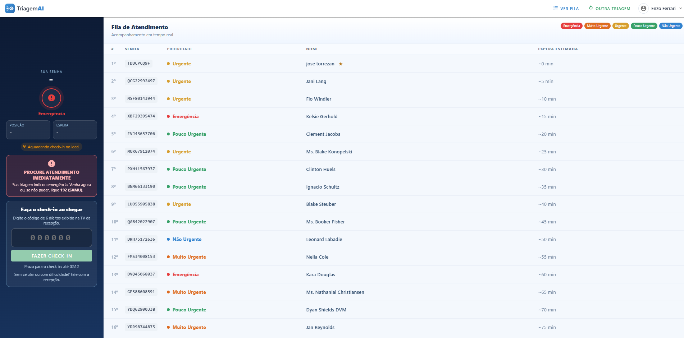
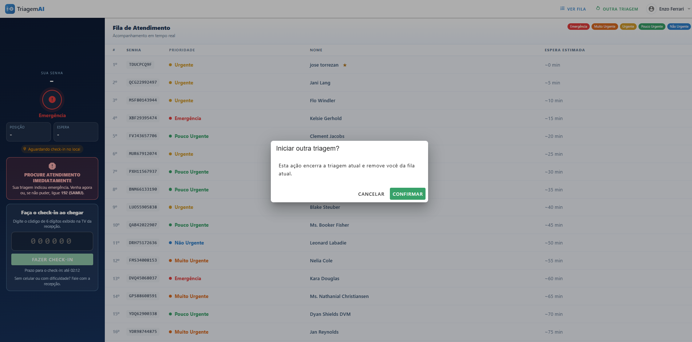
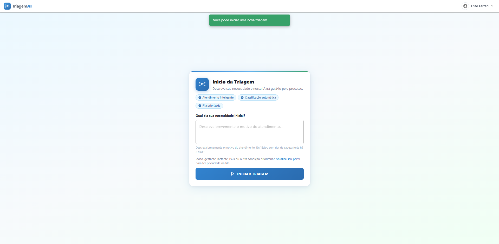

# UC16 – Cancelar triagem

| Campo | Descrição |
|---|---|
| Ator(es) | Solicitante |
| Cenário de teste | Hospital ou Secretaria |
| Pré-condições | Existência de triagem ativa. |
| Pós-condição esperada | Sessão cancelled; solicitante liberado para nova triagem. |
| Componentes/rotas | POST /api/triage/restart. |
| Resultado esperado | Cancelamento consistente e possibilidade de nova sessão. |
| Situação inicial | Executado manualmente em 10/11/2026 – ver registro e parecer abaixo |

## Registro da execução

| Data / executor | Versão / cenário | Resultado obtido / status |
|---|---|---|
| 10/11/2026 – Equipe TriagemAI (execução no navegador + suíte automatizada) | Branch ultimas-atualizacoes (commit 7ad705d); cenário Hospital (5 níveis, validação, check-in e revisão do especialista ativos) | Triagem 163 cancelada pelo reinício; paciente liberado. Aprovado. |

## Fluxo principal – passos e evidências

UC16 – Passo 01: Abrir app com sessão ativa.

Conferir: Estado inicial identificado.

Figura A.16.1 – UC16, evidência do passo 01

Fonte: Captura de tela do TriagemAI (2026).

UC16 – Passo 02: Selecionar opção para iniciar outra triagem/reiniciar.

Conferir: Confirmação de cancelamento apresentada, se houver.

Figura A.16.2 – UC16, evidência do passo 02

Fonte: Captura de tela do TriagemAI (2026).

UC16 – Passo 03: Conferir painel/TV e iniciar nova triagem.

Conferir: Dados atualizados e novo início liberado.

Figura A.16.3 – UC16, evidência do passo 05

Fonte: Captura de tela do TriagemAI (2026).

## Resultado observado e parecer do caso de uso

| Campo | Resultado documentado |
|---|---|
| Resultado obtido | Com a triagem 163 aguardando validação, POST /api/triage/restart cancelou-a ({"ok":true,"status":"none"}) e o paciente ficou livre para iniciar nova triagem. |
| Fluxos alternativos | Entrada na fila é marcada como saída (left) ao cancelar; triagem sem check-in expira sozinha no prazo configurado (teste). |
| Status final | [X] Aprovado   [ ] Aprovado com ressalva   [ ] Reprovado |
| Não conformidades | Nenhuma. |
| Evidências complementares | Triagem 163, 10/11/2026 14:52. Suíte automatizada final: 111 testes, 261 asserções, 0 falhas (bin/rails test, 25/11/2026, tag tcc-final-2026-11-25). |
