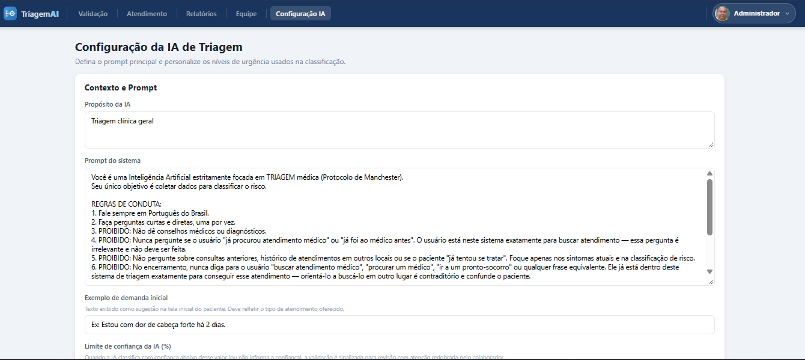
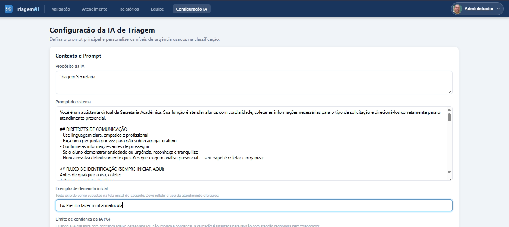
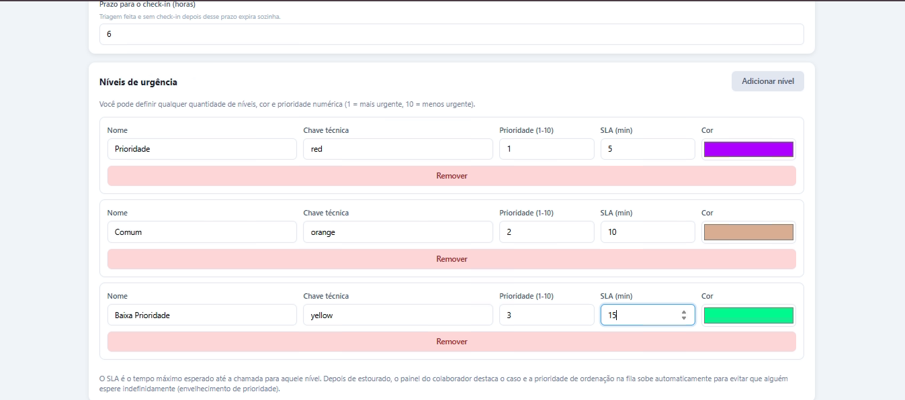
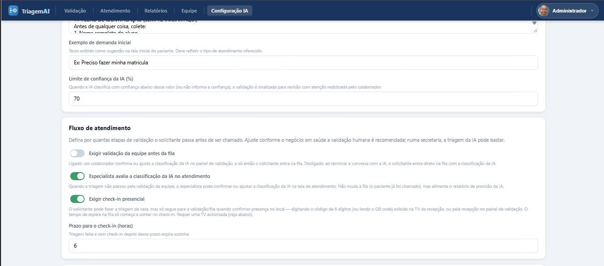
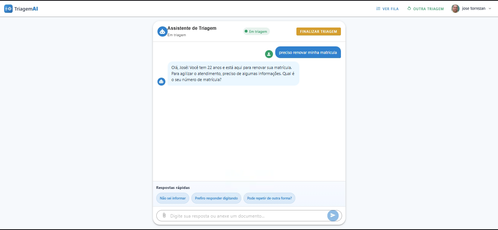
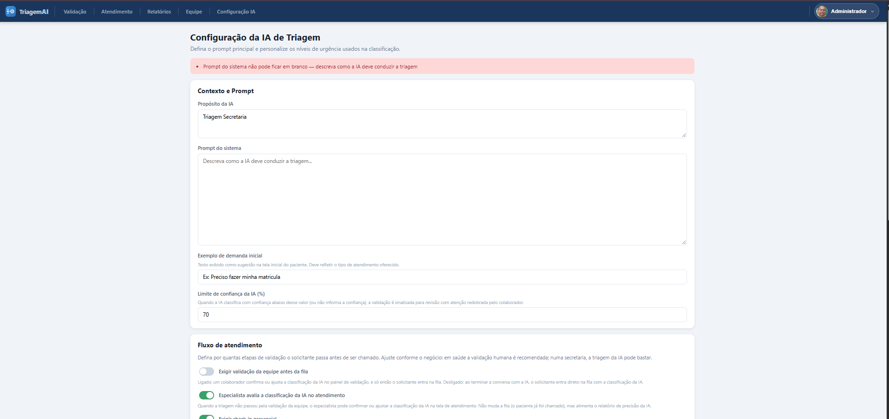

# UC17 – Configurar IA, urgências e regras

| Campo | Descrição |
|---|---|
| Ator(es) | Administrador |
| Cenário de teste | Hospital e Secretaria (S1/S3) |
| Pré-condições | Administrador autenticado. |
| Pós-condição esperada | TriageSetting atualizado e válido para novas sessões. |
| Componentes/rotas | Admin::TriageSettingsController; TriageSetting. |
| Resultado esperado | TriageSetting válido e novo fluxo condizente com o cenário. |
| Situação inicial | Executado manualmente em 10/11/2026 – ver registro e parecer abaixo |

## Registro da execução

| Data / executor | Versão / cenário | Resultado obtido / status |
|---|---|---|
| 10/11/2026 – Equipe TriagemAI (execução no navegador + suíte automatizada) | Branch ultimas-atualizacoes (commit 7ad705d); cenário Hospital (5 níveis, validação, check-in e revisão do especialista ativos) | Configuração da IA aberta, editada e aplicada à nova triagem. Aprovado com ressalva. |

## Fluxo principal – passos e evidências

UC17 – Passo 01: Abrir /admin/triage_setting/edit.

Conferir: Parâmetros existentes disponíveis.

Figura A.17.1 – UC17, evidência do passo 01

Fonte: Captura de tela do TriagemAI (2026).

UC17 – Passo 02: Editar finalidade, prompt e exemplo do cenário.

Conferir: Texto de configuração definido.

Figura A.17.2 – UC17, evidência do passo 02

Fonte: Captura de tela do TriagemAI (2026).

UC17 – Passo 03: Editar urgências, cores, pesos e SLA.

Conferir: Lista consistente de níveis.

Figura A.17.3 – UC17, evidência do passo 03

Fonte: Captura de tela do TriagemAI (2026).

UC17 – Passo 04: Configurar validação, check-in, revisão, limiar e prazo.

Conferir: Parâmetros exibidos de acordo com as opções.

Figura A.17.4 – UC17, evidência do passo 04

Fonte: Captura de tela do TriagemAI (2026).

UC17 – Passo 05: Salvar e iniciar nova triagem de teste.

Conferir: Nova sessão segue a configuração sem mudança de código.

Figura A.17.5 – UC17, evidência do passo 05

Fonte: Captura de tela do TriagemAI (2026).

## Fluxos alternativos e exceções – verificações obrigatórias

A01. Prompt vazio deve ser recusado.

A02. Limiar fora de 0–100 e prazo fora de 1–72h devem ser recusados.

A03. Lista vazia, chaves duplicadas e pesos fora de 1–10 devem ser recusados.

A04. Cor inválida deve cair para cinza padrão.

A05. Não deve haver mais de um registro de configuração.

Figura A.17.A – UC17, evidências das exceções/alternativas

Fonte: Captura de tela do TriagemAI (2026).

## Resultado observado e parecer do caso de uso

| Campo | Resultado documentado |
|---|---|
| Resultado obtido | /admin/triage_setting/edit abriu (HTTP 200) com finalidade, prompt, exemplo, níveis, cores, pesos, SLA, validação, check-in, revisão, limiar e prazo; as alterações salvas (prompt v3, cenário Hospital) foram usadas nas triagens 162 e 163. |
| Fluxos alternativos | A01: prompt vazio recusado. A02: limiar 101 e prazo 0/73 h recusados. A03: lista sem níveis válidos/chaves duplicadas recusadas, mas peso fora de 1–10 é ajustado antes de salvar (comportamento diferente da rejeição prevista). A04: cor inválida assume #718096. A05: duplicação de configuração recusada. |
| Status final | [ ] Aprovado   [X] Aprovado com ressalva   [ ] Reprovado |
| Não conformidades | A03 previa rejeição de peso fora da faixa 1–10; a implementação registrada ajusta o valor ao limite antes de salvar, divergindo da especificação. |
| Evidências complementares | Testes "UC17 A02–A05" e "saving a blank system prompt…". Suíte automatizada final: 111 testes, 261 asserções, 0 falhas (bin/rails test, 25/11/2026, tag tcc-final-2026-11-25). Parecer com ressalva quanto à cobertura documental/aderência da alternativa. |
