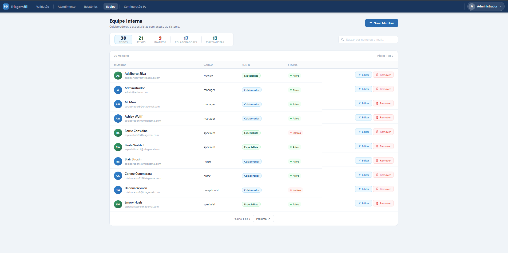
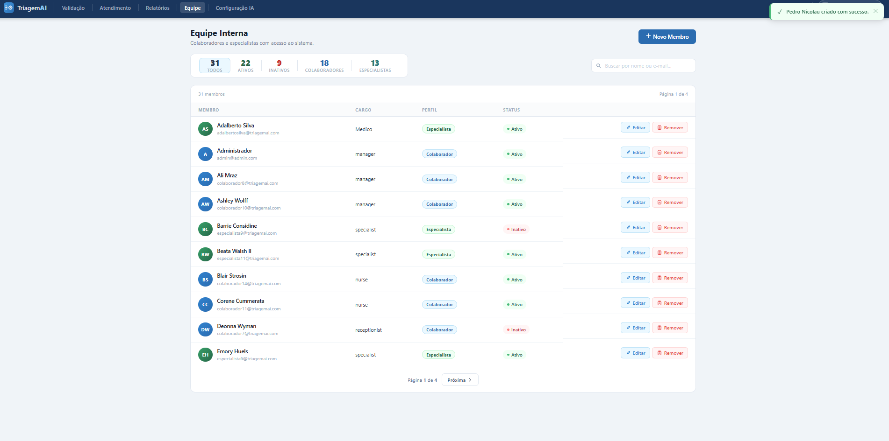
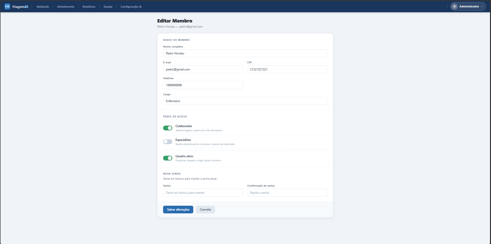
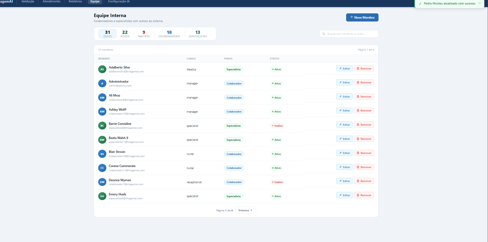
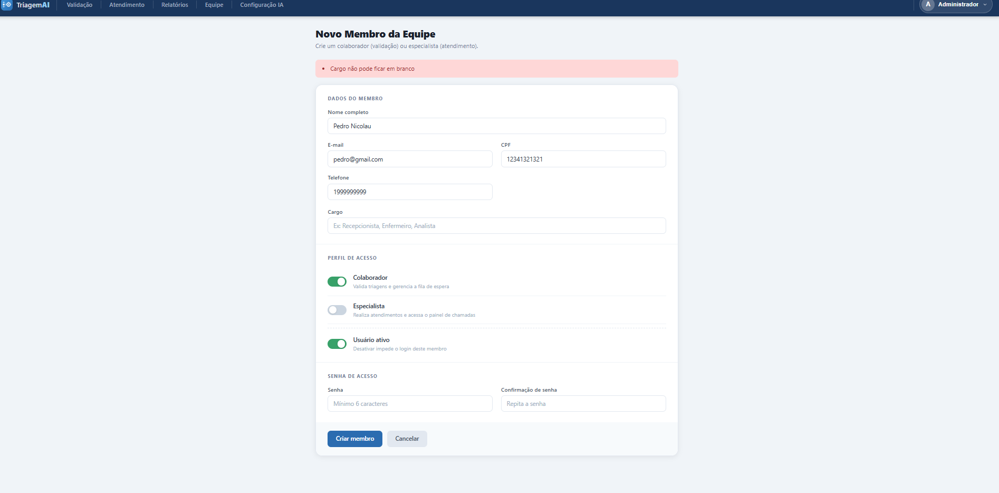
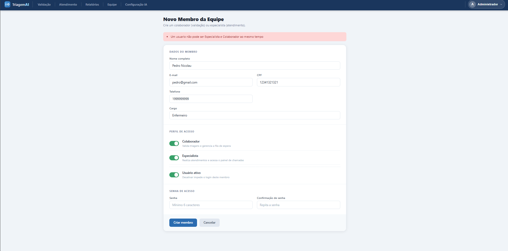
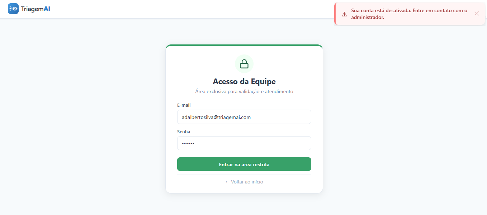

# UC18 – Gerenciar usuários da equipe

| Campo | Descrição |
|---|---|
| Ator(es) | Administrador |
| Cenário de teste | Hospital ou Secretaria |
| Pré-condições | Administrador autenticado. |
| Pós-condição esperada | Equipe atualizada respeitando perfis e histórico. |
| Componentes/rotas | Admin::UsersController; User. |
| Resultado esperado | Usuários geridos sem violar regras de acesso e rastreabilidade. |
| Situação inicial | Executado manualmente em 10/11/2026 – ver registro e parecer abaixo |

## Registro da execução

| Data / executor | Versão / cenário | Resultado obtido / status |
|---|---|---|
| 10/11/2026 – Equipe TriagemAI (execução no navegador + suíte automatizada) | Branch ultimas-atualizacoes (commit 7ad705d); cenário Hospital (5 níveis, validação, check-in e revisão do especialista ativos) | Listagem, criação, edição e regras de exclusão da equipe conferidas. Aprovado. |

## Fluxo principal – passos e evidências

UC18 – Passo 01: Abrir listagem de usuários da equipe.

Conferir: Colaboradores e especialistas cadastrados visíveis.

Figura A.18.1 – UC18, evidência do passo 01

Fonte: Captura de tela do TriagemAI (2026).

UC18 – Passo 02: Criar conta com perfil e cargo apropriados.

Conferir: Usuário de equipe criado.

Figura A.18.2 – UC18, evidência do passo 02

Fonte: Captura de tela do TriagemAI (2026).

UC18 – Passo 03: Editar os dados.

Conferir: Alterações persistidas.

Figura A.18.3 – UC18, evidência do passo 03

Fonte: Captura de tela do TriagemAI (2026).

UC18 – Passo 04: Tentar excluir conta sem histórico e verificar resultado.

Conferir: Remoção permitida conforme regra.

Figura A.18.4 – UC18, evidência do passo 04

Fonte: Captura de tela do TriagemAI (2026).

## Fluxos alternativos e exceções – verificações obrigatórias

A01. Cargo é obrigatório para colaborador e especialista.

A02. Uma mesma conta não pode ser colaborador e especialista simultaneamente.

A03. Conta desativada não pode entrar.

Figura A.18.A – UC18, evidências das exceções/alternativas

Fonte: Captura de tela do TriagemAI (2026).

## Resultado observado e parecer do caso de uso

| Campo | Resultado documentado |
|---|---|
| Resultado obtido | /admin/users listou a equipe (HTTP 200); criação e edição respeitam perfil e cargo; quem nunca participou de atendimento pode ser excluído e quem participou fica bloqueado (apenas desativação). |
| Fluxos alternativos | A01: cargo obrigatório para colaborador e especialista. A02: mesma conta como colaborador e especialista recusada com mensagem em português. A03: conta desativada não entra. |
| Status final | [X] Aprovado   [ ] Aprovado com ressalva   [ ] Reprovado |
| Não conformidades | Nenhuma. |
| Evidências complementares | Testes "UC18 A01" e admin_fixes_test (exclusão, dupla função, conta inativa). Suíte automatizada final: 111 testes, 261 asserções, 0 falhas (bin/rails test, 25/11/2026, tag tcc-final-2026-11-25). |
