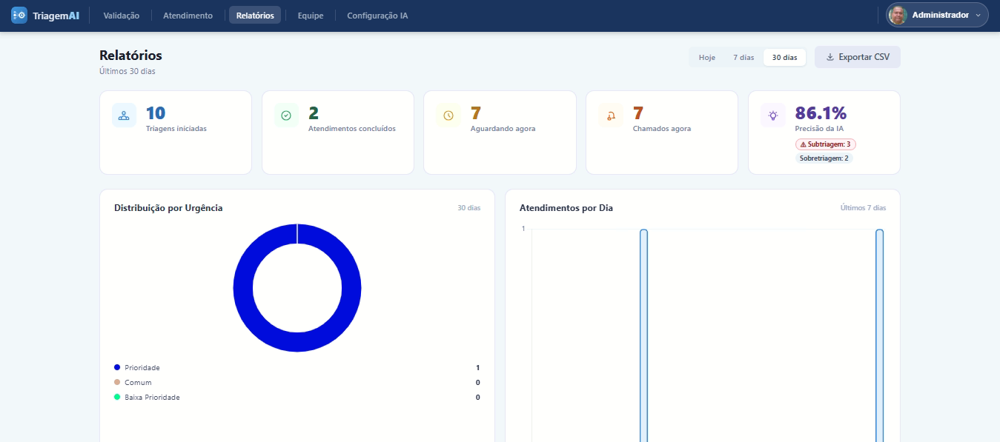
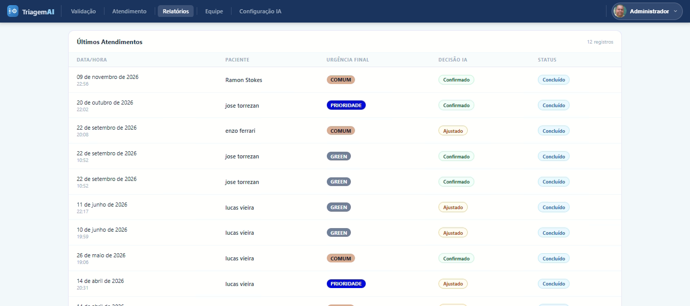
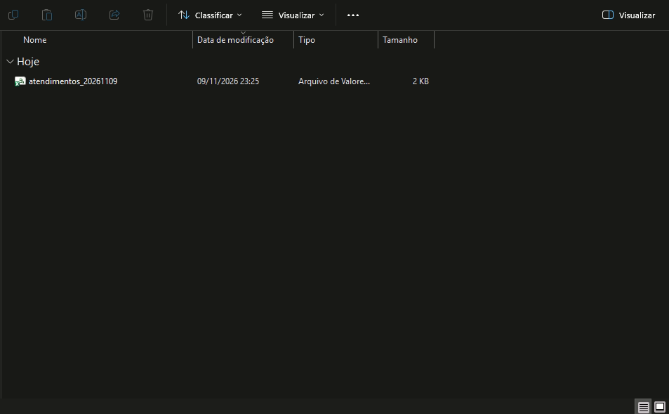
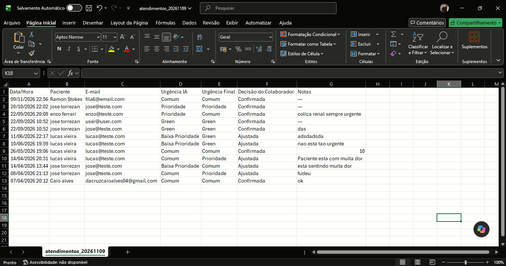
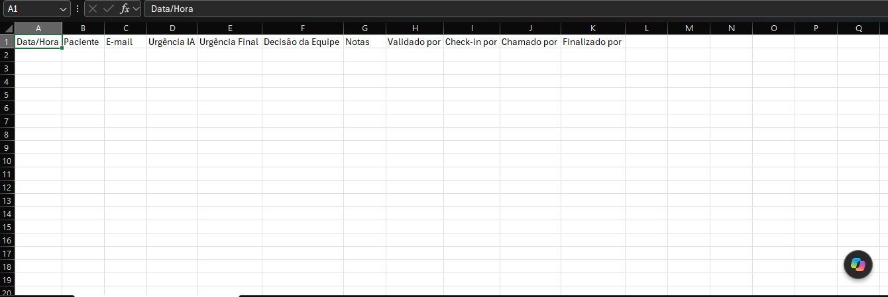

# UC19 – Consultar relatórios e exportar CSV

| Campo | Descrição |
|---|---|
| Ator(es) | Administrador |
| Cenário de teste | Hospital ou Secretaria |
| Pré-condições | Administrador autenticado. |
| Pós-condição esperada | Arquivo CSV gerado; relatório consultável. |
| Componentes/rotas | Validation::ReportsController#index e #export_csv. |
| Resultado esperado | Relatório consultável e CSV válido. |
| Situação inicial | Executado manualmente em 10/11/2026 – ver registro e parecer abaixo |

## Registro da execução

| Data / executor | Versão / cenário | Resultado obtido / status |
|---|---|---|
| 10/11/2026 – Equipe TriagemAI (execução no navegador + suíte automatizada) | Branch ultimas-atualizacoes (commit 7ad705d); cenário Hospital (5 níveis, validação, check-in e revisão do especialista ativos) | Relatório com filtros, indicadores e exportação CSV funcionando. Aprovado após correção. |

## Fluxo principal – passos e evidências

UC19 – Passo 01: Abrir /validation/reports.

Conferir: Tela de relatórios acessível.

Figura A.19.1 – UC19, evidência do passo 01

Fonte: Captura de tela do TriagemAI (2026).

UC19 – Passo 02: Consultar lista de registros de atendimento.

Conferir: Dados condizentes com a massa de testes.

Figura A.19.2 – UC19, evidência do passo 02

Fonte: Captura de tela do TriagemAI (2026).

UC19 – Passo 03: Acionar a exportação em CSV.

Conferir: Download ou geração de CSV.

Figura A.19.3 – UC19, evidência do passo 03

Fonte: Captura de tela do TriagemAI (2026).

UC19 – Passo 04: Abrir o arquivo exportado e conferir colunas/linhas.

Conferir: Conteúdo corresponde aos registros filtrados/visualizados.

Figura A.19.4 – UC19, evidência do passo 04

Fonte: Captura de tela do TriagemAI (2026).

## Fluxos alternativos e exceções – verificações obrigatórias

A01. Quando não houver dados, relatório deve permanecer vazio sem erro.

A02. Confirmar no teste os campos e filtros disponíveis na implementação real.

Figura A.19.A – UC19, evidências das exceções/alternativas

Fonte: Captura de tela do TriagemAI (2026).

## Resultado observado e parecer do caso de uso

| Campo | Resultado documentado |
|---|---|
| Resultado obtido | /validation/reports (somente admin) mostrou triagens iniciadas, atendimentos concluídos, fila agora e o indicador de concordância IA × equipe (rótulo renomeado após a revisão; antes exibido como “Precisão da IA”), além da lista de atendimentos; a exportação CSV (text/csv) trouxe as colunas Data/Hora, Paciente, E-mail, Urgência IA, Urgência Final, Decisão da Equipe, Notas, Validado por, Check-in por, Chamado por e Finalizado por. |
| Fluxos alternativos | A01: período sem dados (desde 01/01/2020) exibe o relatório vazio, sem erro (HTTP 200). A02: filtros disponíveis são período (hoje, semana, mês), data inicial/final e membro da equipe; datas inválidas voltam ao padrão. |
| Status final | [X] Aprovado   [ ] Aprovado com ressalva   [ ] Reprovado |
| Não conformidades | Encontrada e corrigida durante o teste: o indicador usava só o campo de decisão, e registros antigos marcados como "confirmado" com nível alterado o inflavam. Agora ele compara o nível da IA com o nível final. Após a revisão do orientador, o rótulo na interface foi renomeado de "Precisão da IA" para "Concordância IA × equipe"; o CSV não usa esse rótulo. Reteste aprovado. |
| Evidências complementares | Teste "AI accuracy compares the AI level with the final level…" e attendance_history_and_reports_test (filtros e CSV). Suíte automatizada final: 111 testes, 261 asserções, 0 falhas (bin/rails test, 25/11/2026, tag tcc-final-2026-11-25). |
